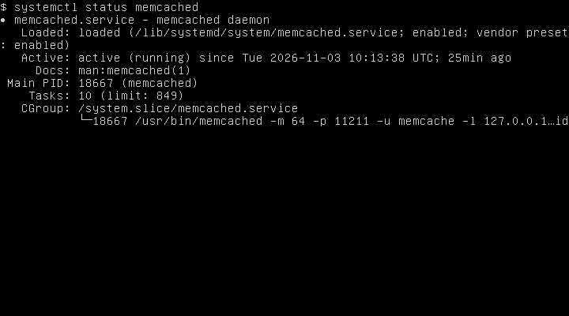
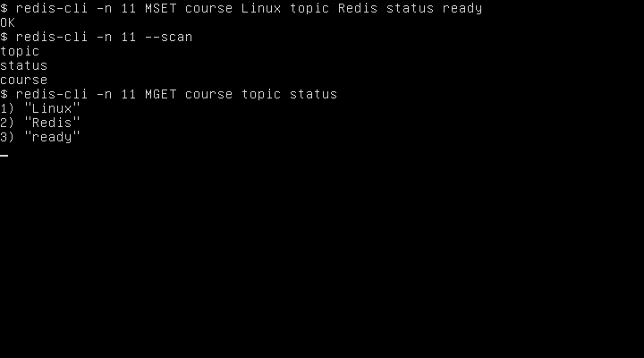

# Домашнее задание 11.02 «Кеширование Redis/memcached» — Колесникова Анастасия

## Задание 1. Кеширование

- **Медленная загрузка страниц.** Карточку популярного товара можно на короткое время сохранить в кеше и отдавать сразу, экономя время на запросах к базе и сборке страницы.
- **Высокая нагрузка на базу данных.** Если тысячи пользователей открывают один каталог, кеш результатов запроса сокращает число повторных чтений из базы.
- **Повторные тяжёлые вычисления.** Дневной отчёт можно рассчитать один раз и отдавать готовый результат до очередного обновления.
- **Ограничения внешнего API.** Если сервис погоды ограничивает число запросов, ответ для каждого города можно хранить несколько минут и использовать для следующих обращений.

## Задание 2. Memcached

## Задание 3. Удаление по TTL в Memcached

## Задание 4. Запись данных в Redis

## Задание 5*. Работа с числами

