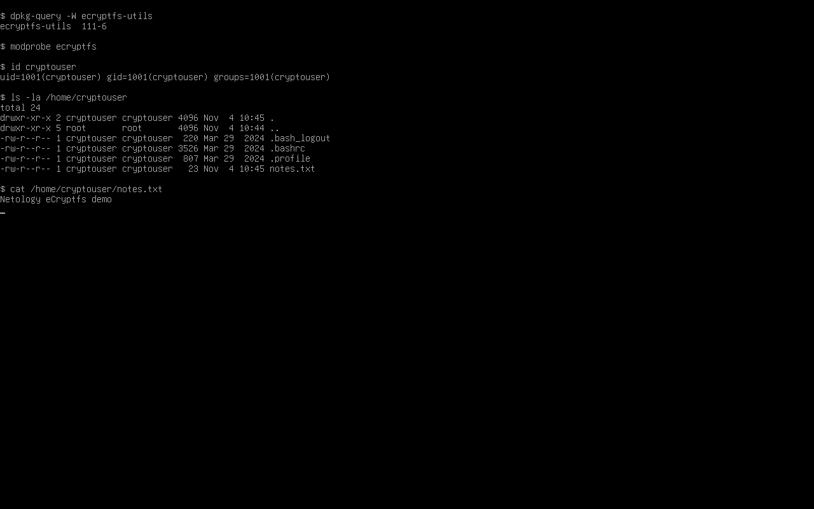
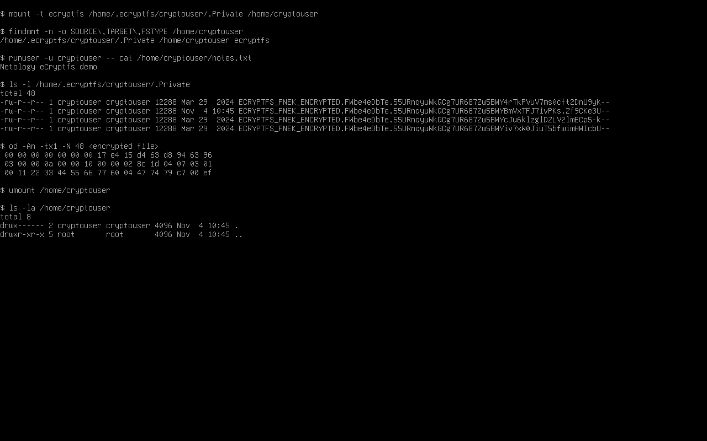
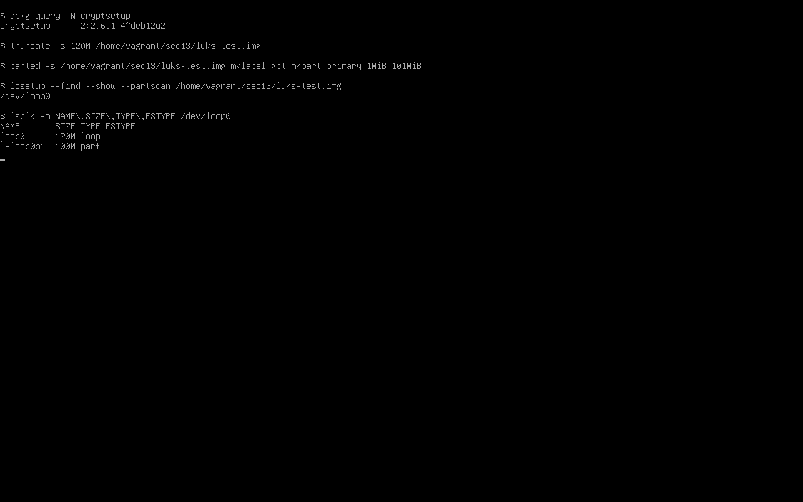
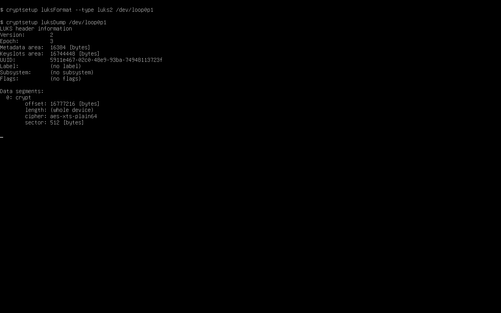
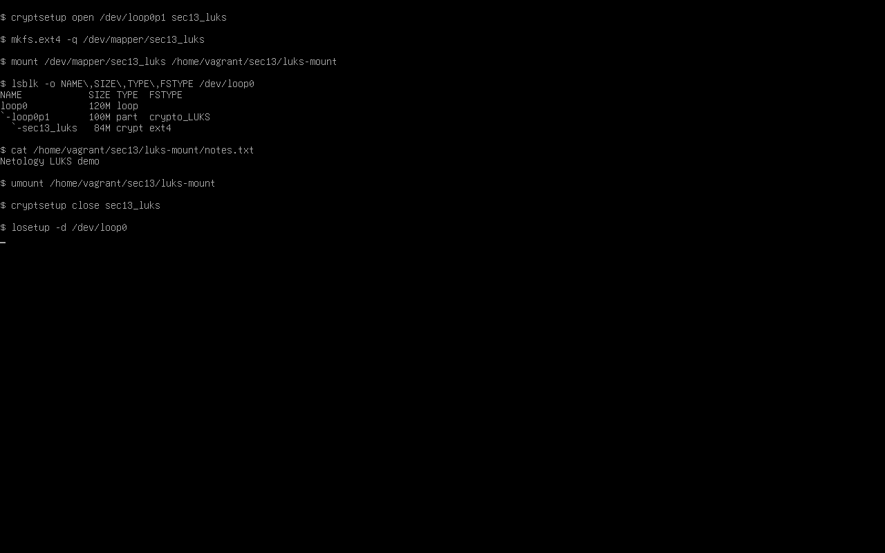
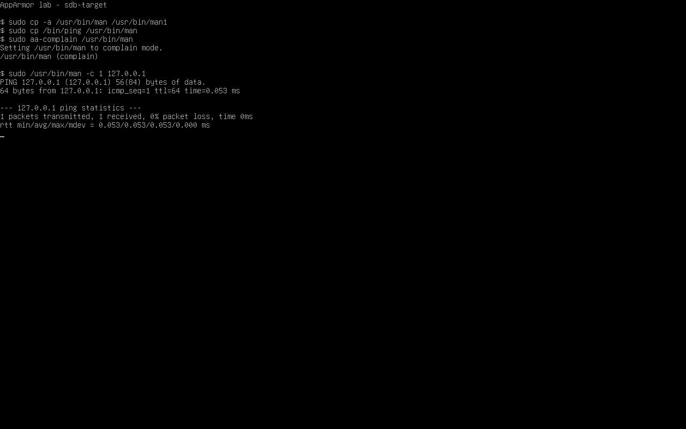
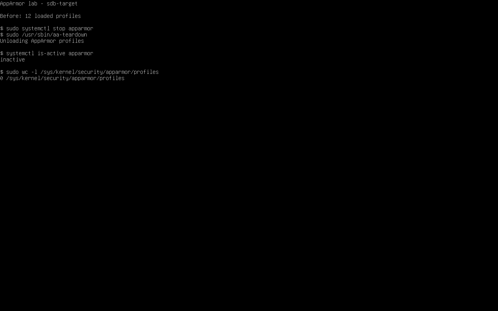

# Домашнее задание 13.02 «Защита хоста» — Колесникова Анастасия

## Задание 1. eCryptfs

## Задание 2. LUKS

## Задание 3*. AppArmor

Повторила опыт со слайда 21 презентации «Защита хоста». Сохранила исходный `/usr/bin/man` и временно заменила его копией `/bin/ping`. Поскольку профиль `man` на учебной машине уже был в режиме `enforce`, для первого запуска перевела его в `complain`. Команда `sudo /usr/bin/man -c 1 127.0.0.1` получила один ответ.

После `sudo aa-enforce /usr/bin/man` повторила ту же команду. AppArmor заблокировал создание сокета, и команда вернула `socket: Permission denied`. После опыта восстановила исходный `/usr/bin/man`.

После эксперимента остановила службу командой `sudo systemctl stop apparmor` и выгрузила профили командой `sudo /usr/sbin/aa-teardown`. Служба перешла в состояние `inactive`, а число загруженных профилей снизилось с 12 до 0. После проверки снова запустила службу и убедилась, что все 12 профилей восстановлены.

