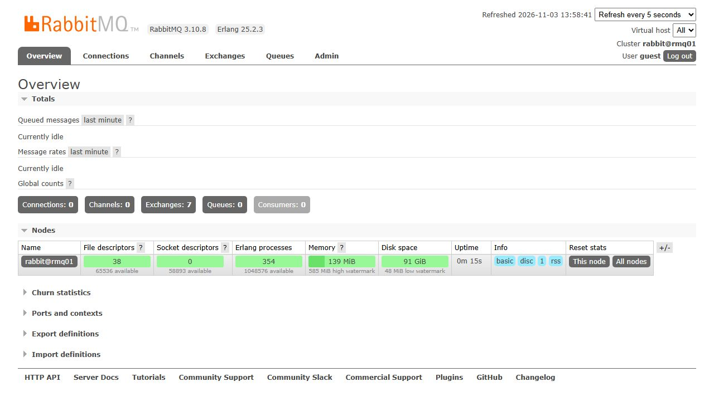
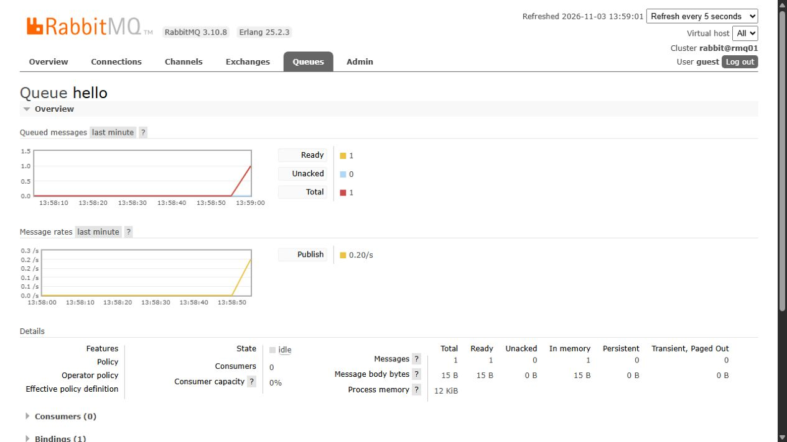
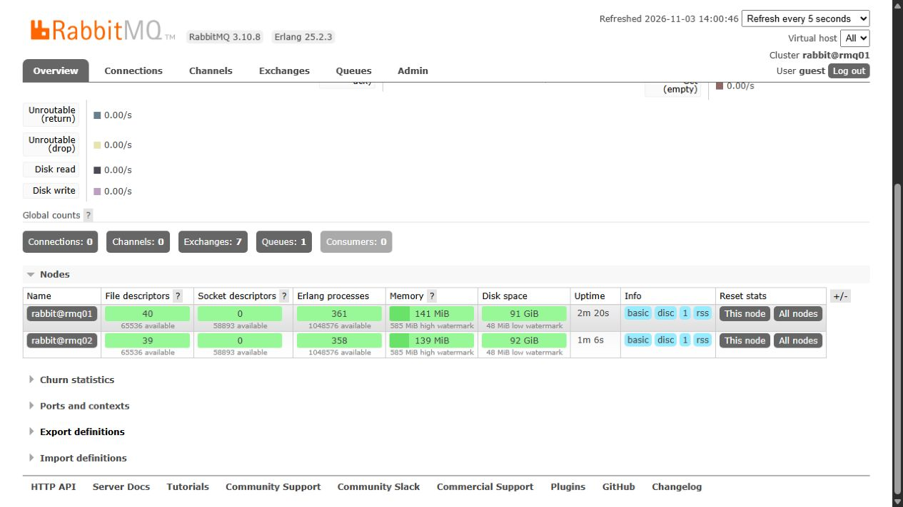
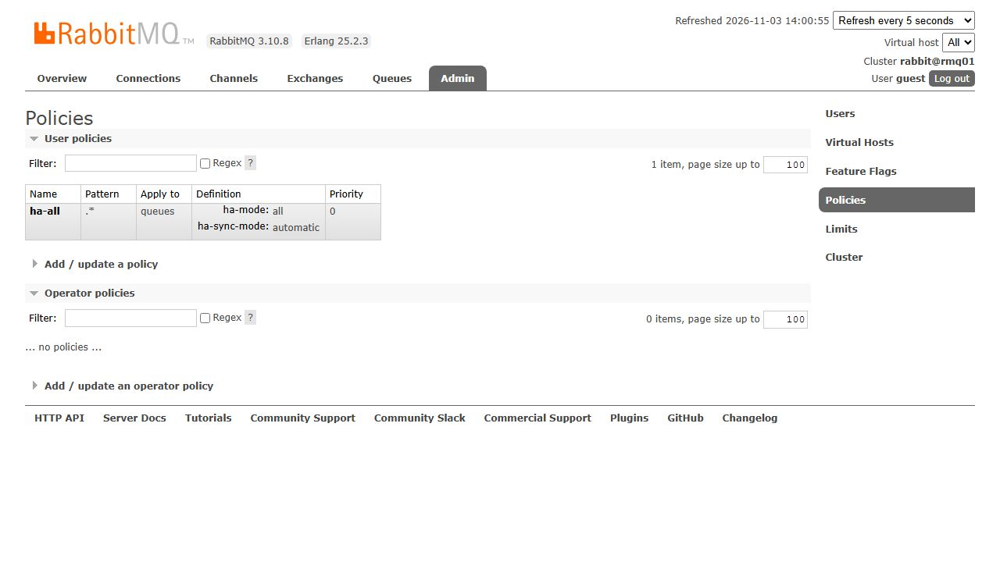
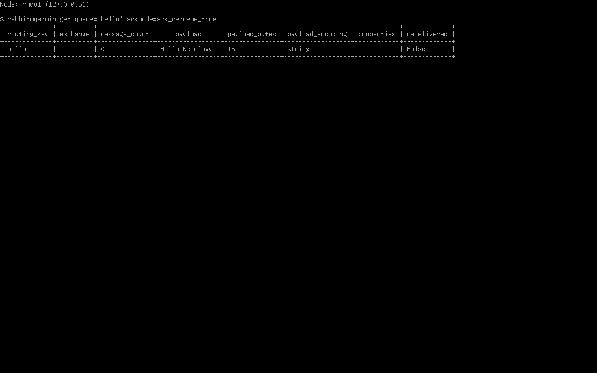

# Домашнее задание 11.04 «Очереди RabbitMQ» — Колесникова Анастасия

## Задание 1. Установка RabbitMQ

## Задание 2. Отправка и получение сообщений

## Задание 3. Подготовка HA-кластера

Вывод `rabbitmqctl cluster_status` с обоих узлов — [rmq01](06_cluster_status_rmq01.txt) и [rmq02](07_cluster_status_rmq02.txt).

## Задание 4*. Ansible playbook

[Плейбук установки RabbitMQ, сборки кластера и применения политики ha-all](ansible/rabbitmq.yml) · [Инвентарь](ansible/inventory.yml)
