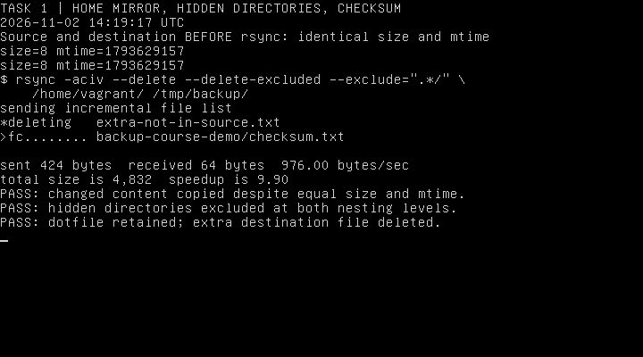
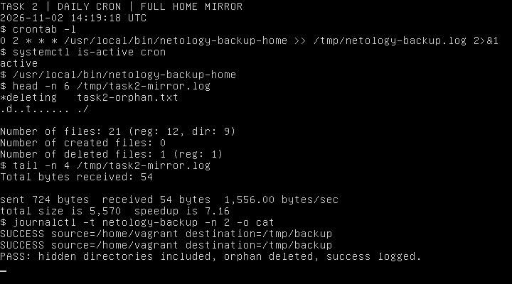
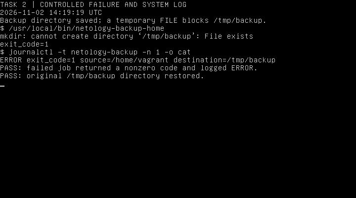
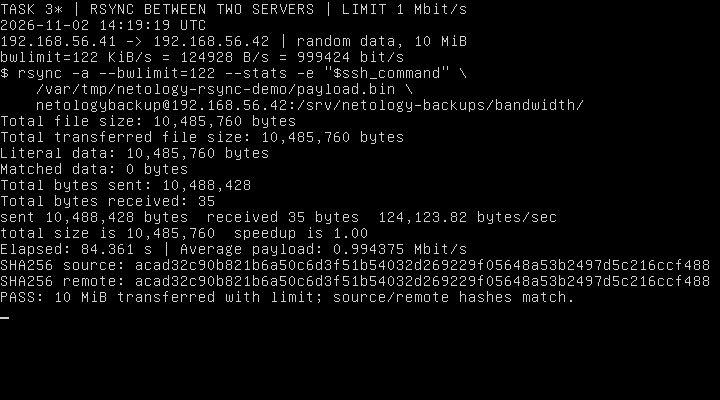
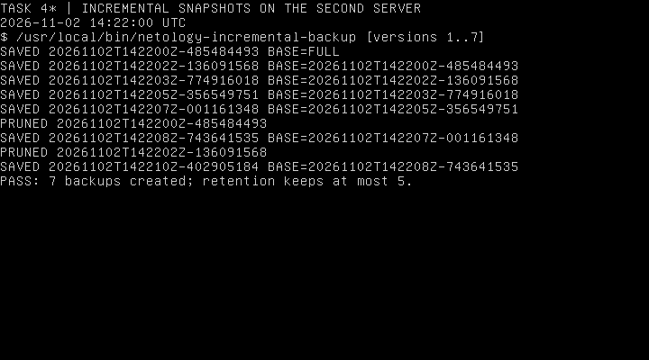
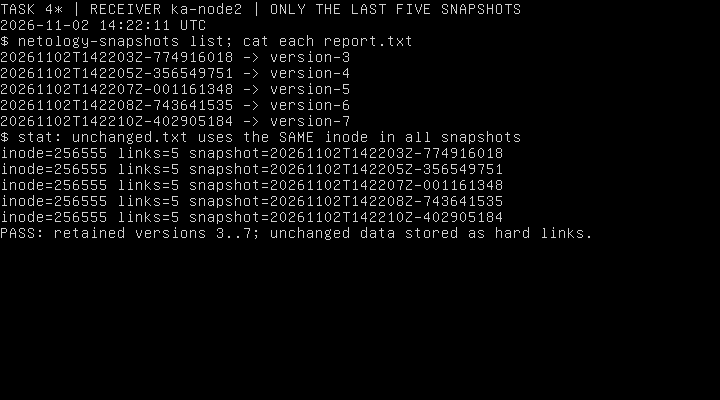
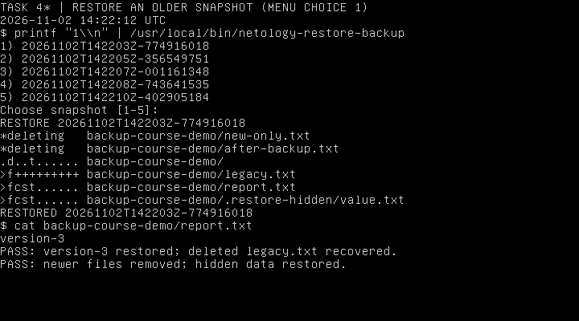
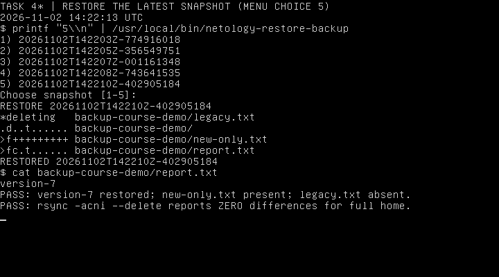

# Домашнее задание к занятию 3 «Резервное копирование» — Колесникова Анастасия

[Условие домашнего задания](https://github.com/netology-code/sflt-homeworks/blob/main/3.md)

Выполнены задания **1 и 2**, а также **3 и 4 со звёздочкой**. Использованы две локальные ВМ Ubuntu 18.04.6 LTS с rsync 3.1.2:

| Назначение | Имя ВМ | IP | Пользователь |
| --- | --- | --- | --- |
| Источник, домашний каталог `/home/vagrant` | ka-node1 | 192.168.56.41 | vagrant |
| Приёмник удалённых резервных копий | ka-node2 | 192.168.56.42 | netologybackup |

На приёмнике создан отдельный пользователь без sudo. Резервные копии хранятся в `/srv/netology-backups/`, доступ к этому каталогу ограничен правами `0700`. Передача выполняется по SSH с отдельным ключом; его использование ограничено адресом исходной ВМ и опцией `restrict`. Ключ хоста приёмника закреплён в отдельном `known_hosts`, включена строгая проверка. Приватные ключи и содержимое резервных копий в репозиторий не включены.

## Задание 1. Зеркальная копия с исключением скрытых директорий

Использована команда:

```bash
rsync -aciv --delete --delete-excluded --exclude='.*/' \
    /home/vagrant/ /tmp/backup/
```

- `-a` — архивный режим: рекурсивное копирование с сохранением атрибутов.
- `-c` — сравнение содержимого по контрольным суммам, даже при одинаковых размере и времени изменения.
- `-i` и `-v` — вывод изменений и результата выполнения.
- `--delete` — удаление из копии файлов, отсутствующих в источнике.
- `--exclude='.*/'` — исключение директорий, имя которых начинается с точки, на любом уровне вложенности. Обычные скрытые **файлы** этим правилом не исключаются.
- `--delete-excluded` — удаление из приёмника также ранее скопированных директорий, попавших под исключение.

Завершающий `/` у источника означает копирование содержимого домашнего каталога непосредственно в `/tmp/backup/`.

Для проверки сначала создана копия, затем содержимое `backup-course-demo/checksum.txt` изменено с `alpha-A` на `alpha-B`. Размер остался **8 байт**, а время изменения источника выставлено равным времени файла в копии. Несмотря на это, rsync обнаружил изменение и передал файл, что видно по строке `>fc........`.

Дополнительно проверено: скрытые директории на двух уровнях вложенности отсутствуют в копии, скрытый файл `.backup-course-dotfile` присутствует, лишний файл приёмника удалён.



## Задание 2. Ежедневное зеркальное копирование и системный лог

Файлы решения:

- [02_backup-home.sh](02_backup-home.sh) — установлен как `/usr/local/bin/netology-backup-home`, права `0755`.
- [03_crontab](03_crontab) — задание в пользовательском crontab пользователя `vagrant`.

```cron
0 2 * * * /usr/local/bin/netology-backup-home >> /tmp/netology-backup.log 2>&1
```

Копирование запланировано **каждый день в 02:00 по времени ВМ (UTC)**. Служба `cron` запущена и включена в автозагрузку.

Скрипт выполняет:

```bash
rsync -a --delete --itemize-changes --stats /home/vagrant/ /tmp/backup/
```

В отличие от задания 1, здесь исключений нет: копируется **весь** домашний каталог, включая скрытые файлы и директории. `--delete` обеспечивает зеркало. Блокировка `flock` предотвращает одновременное выполнение двух экземпляров.

Обработчик завершения записывает результат через `logger -t netology-backup` в системный журнал:

```text
SUCCESS source=/home/vagrant destination=/tmp/backup
ERROR exit_code=<код> source=/home/vagrant destination=/tmp/backup
```

### Успешное выполнение

После установки ежедневного расписания та же команда скрипта выполнена вручную для проверки без ожидания следующего дня. Проверены включение скрытых директорий, удаление лишнего файла в копии и появление записи `SUCCESS` в системном журнале.



### Неуспешное выполнение

Для контролируемой проверки каталог с готовой копией временно переименован, а путь `/tmp/backup` занят тестовым обычным файлом. Скрипт завершился с кодом **1** и записал `ERROR exit_code=1` в системный журнал. После проверки тестовый файл удалён, исходный каталог резервной копии возвращён на место.



## Задание 3*. Ограничение пропускной способности до 1 Мбит/с

На исходной ВМ создан файл из случайных данных размером **10 МиБ — 10 485 760 байт**. Выполнена передача на вторую ВМ:

```bash
ssh_command='ssh -i /home/vagrant/.ssh/netology_backup -o BatchMode=yes -o IdentitiesOnly=yes -o StrictHostKeyChecking=yes -o UserKnownHostsFile=/home/vagrant/.ssh/netology_backup_known_hosts'

rsync -a --bwlimit=122 --stats -e "$ssh_command" \
    /var/tmp/netology-rsync-demo/payload.bin \
    netologybackup@192.168.56.42:/srv/netology-backups/bandwidth/
```

Без суффикса `--bwlimit` задаётся в КиБ/с. Поэтому выбрано значение **122**, чтобы не превысить десятичный предел 1 Мбит/с:

```text
122 × 1024 = 124 928 байт/с
124 928 × 8 = 999 424 бит/с < 1 000 000 бит/с
```

Фактический результат:

| Показатель | Значение |
| --- | --- |
| Объём переданного файла | 10 485 760 байт |
| Время операции | 84,361 с |
| Средняя скорость полезных данных | 0,994375 Мбит/с |
| Сравнение SHA256 источника и приёмника | Совпадают |

Данные переданы полностью, сжатие не использовалось. На снимке видны команда, статистика rsync, измеренное время и обе контрольные суммы.



## Задание 4*. Удалённые инкрементные копии, хранение пяти версий и восстановление

Файлы решения:

- [07_incremental-backup.sh](07_incremental-backup.sh) — создание копии; установлен на `ka-node1` как `/usr/local/bin/netology-incremental-backup`.
- [08_restore-backup.sh](08_restore-backup.sh) — выбор копии и восстановление; установлен на `ka-node1` как `/usr/local/bin/netology-restore-backup`.
- [09_manage-snapshots.sh](09_manage-snapshots.sh) — подготовка, публикация и удаление старых снимков; установлен на `ka-node2` как `/usr/local/bin/netology-snapshots`.

### Создание и хранение снимков

Первый запуск копирует весь `/home/vagrant/` на второй сервер. Последующие запуски используют `rsync -a --checksum --delete --link-dest=<предыдущий снимок>`: изменённые файлы копируются, а неизменённые связываются с предыдущей копией жёсткими ссылками. Каждый каталог снимка при этом содержит полное дерево файлов, пригодное для восстановления.

Копия сначала создаётся в `.incomplete-<идентификатор>`. Только после успешного rsync каталог переименовывается в завершённый снимок. Затем удаляются самые старые завершённые снимки, остаются только **пять последних**. Незавершённая передача не публикуется и не запускает удаление старых копий. Идентификаторы содержат дату и время UTC с наносекундами; перед файловыми операциями они проверяются по строгому формату.

Запуск на исходной ВМ:

```bash
/usr/local/bin/netology-incremental-backup
```

Выполнено **семь последовательных запусков** с изменением `report.txt` от `version-1` до `version-7`. После шестого и седьмого запусков выведены сообщения `PRUNED` для двух самых старых копий.



На приёмнике остались:

| Снимок | Содержимое report.txt |
| --- | --- |
| 20261102T142203Z-774916018 | version-3 |
| 20261102T142205Z-356549751 | version-4 |
| 20261102T142207Z-001161348 | version-5 |
| 20261102T142208Z-743641535 | version-6 |
| 20261102T142210Z-402905184 | version-7 |

Файл `unchanged.txt` во всех пяти снимках имеет **одинаковый inode 256555** и число ссылок **5**. Это подтверждает инкрементное хранение неизменённых данных через hard links, а не пять независимых копирований файла.



### Выбор копии и восстановление старого состояния

```bash
/usr/local/bin/netology-restore-backup
```

Скрипт показывает меню доступных копий и запрашивает номер. Также можно передать идентификатор снимка аргументом. Проверяется существование выбранной завершённой копии, затем выполняется обратный rsync с `--checksum` и `--delete` в `/home/vagrant/`.

Перед проверкой испорчен `report.txt`, изменён файл в скрытой директории и создан файл после последнего резервного копирования. В меню выбран **пункт 1 — version-3**. Результат:

- восстановлено содержимое `version-3`;
- возвращён `legacy.txt`, который позднее был удалён;
- удалены `new-only.txt` и `after-backup.txt`, которых в выбранной версии ещё не было;
- восстановлены данные в скрытой директории.



### Восстановление последнего состояния

Повторно открыт тот же скрипт и выбран **пункт 5 — version-7**. Содержимое `report.txt` вернулось к `version-7`, файл `new-only.txt` появился, а `legacy.txt` был удалён в соответствии с выбранным состоянием.

Дополнительно выполнена проверка **всего домашнего каталога** обратным `rsync -acni --delete` относительно последнего снимка: список отличий пуст. Все файлы соответствуют восстановленной копии.



## Проверка и завершение

Все четыре Bash-скрипта проверены `bash -n`. Их контрольные суммы совпадают с установленными на ВМ файлами; файл `03_crontab` совпадает с установленным ежедневным расписанием.

Использована [официальная документация rsync](https://download.samba.org/pub/rsync/rsync.1): `--checksum`, правила исключений, `--delete`, `--bwlimit` и `--link-dest`.
