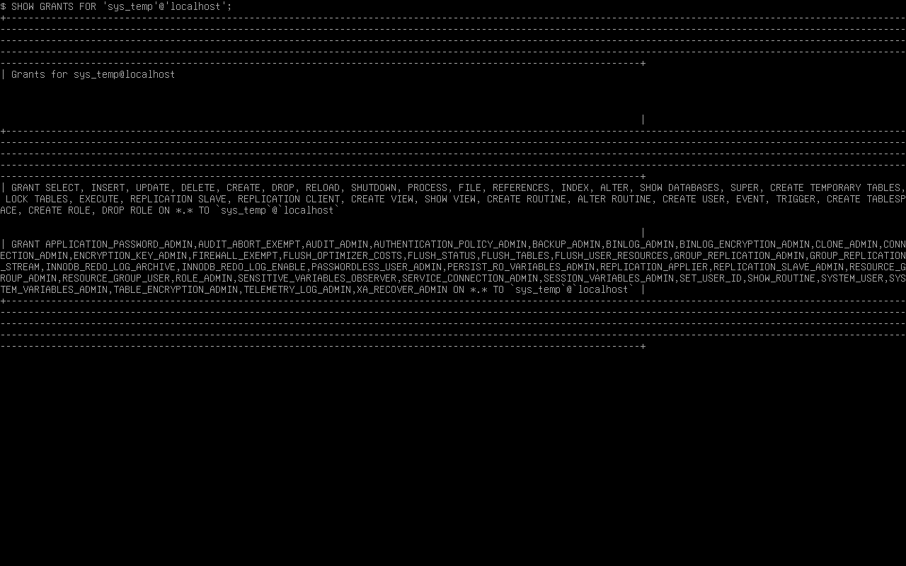
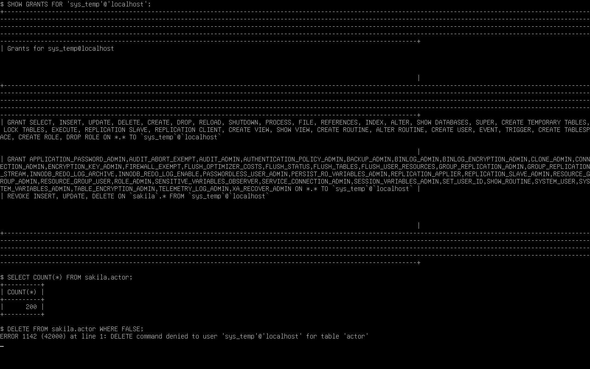

# Домашнее задание 12.02 «Работа с данными (DDL/DML)» — Колесникова Анастасия

## Задание 1. MySQL и восстановление Sakila

[Все запросы и команды импорта](ddl-dml.sql) · [Официальный архив Sakila](https://downloads.mysql.com/docs/sakila-db.zip)

## Задание 2. Первичные ключи Sakila

| Таблица | Первичный ключ |
|---|---|
| actor | actor_id |
| address | address_id |
| category | category_id |
| city | city_id |
| country | country_id |
| customer | customer_id |
| film | film_id |
| film_actor | actor_id, film_id |
| film_category | film_id, category_id |
| film_text | film_id |
| inventory | inventory_id |
| language | language_id |
| payment | payment_id |
| rental | rental_id |
| staff | staff_id |
| store | store_id |

## Задание 3*. Отзыв прав на изменение Sakila

