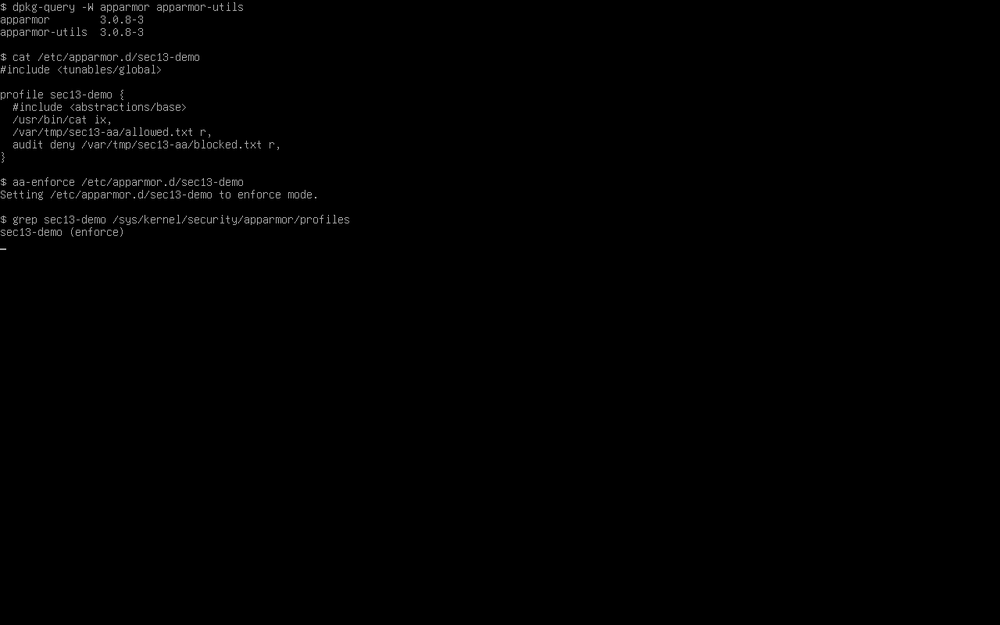
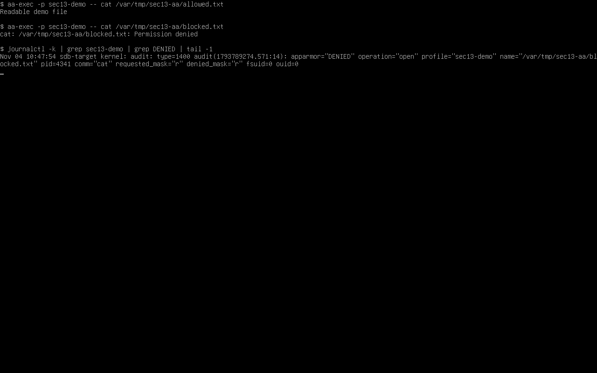

# Домашнее задание 13.02 «Защита хоста» — Колесникова Анастасия

## Задание 1. eCryptfs

## Задание 2. LUKS

## Задание 3*. AppArmor

Проверил механизм на отдельном профиле `sec13-demo`. Профиль в режиме `enforce` разрешает чтение одного файла и запрещает чтение второго. Приложение получило `Permission denied`, ядро записало `apparmor="DENIED"`.

Точные шаги эксперимента из лекции пока не сверены с материалом занятия. Отключение AppArmor на учебной ВМ ожидает отдельного разрешения.
