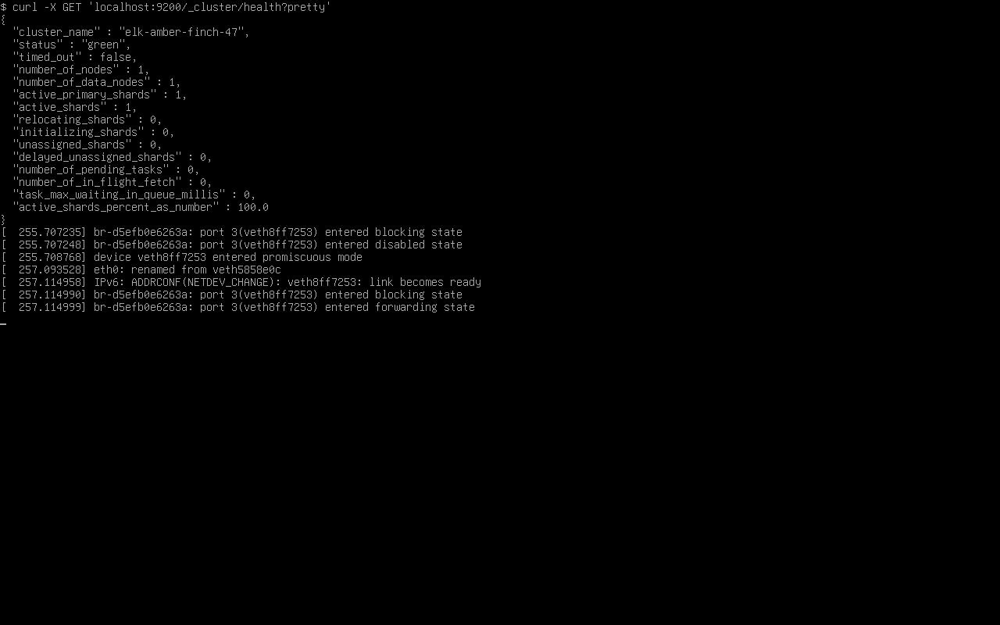
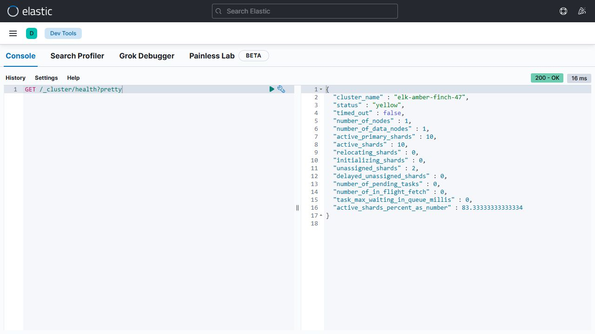
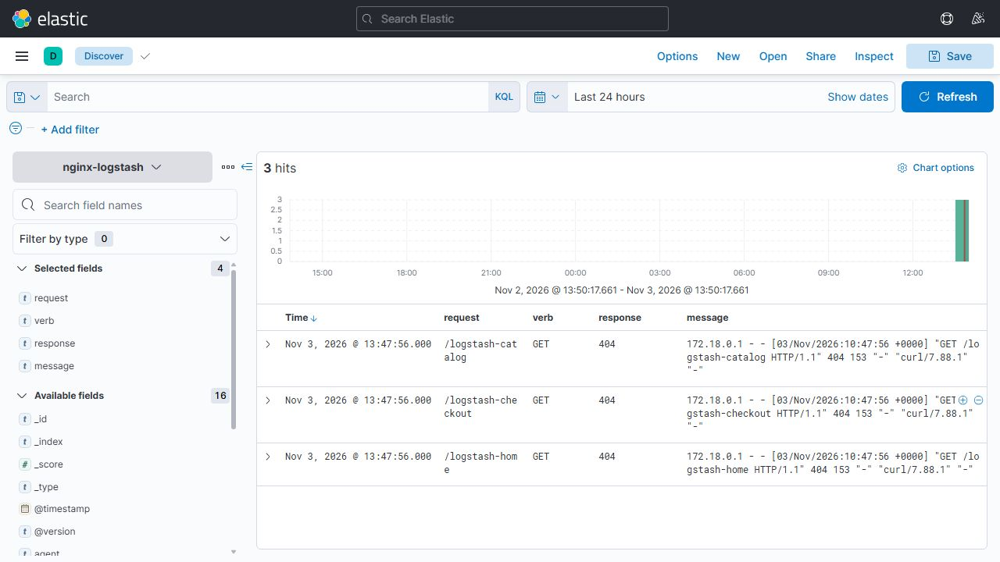
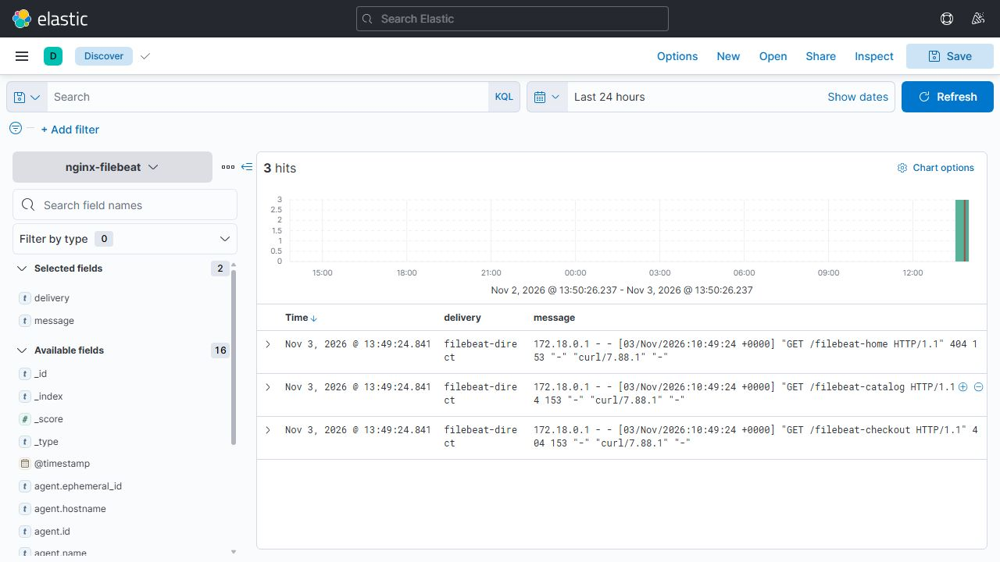
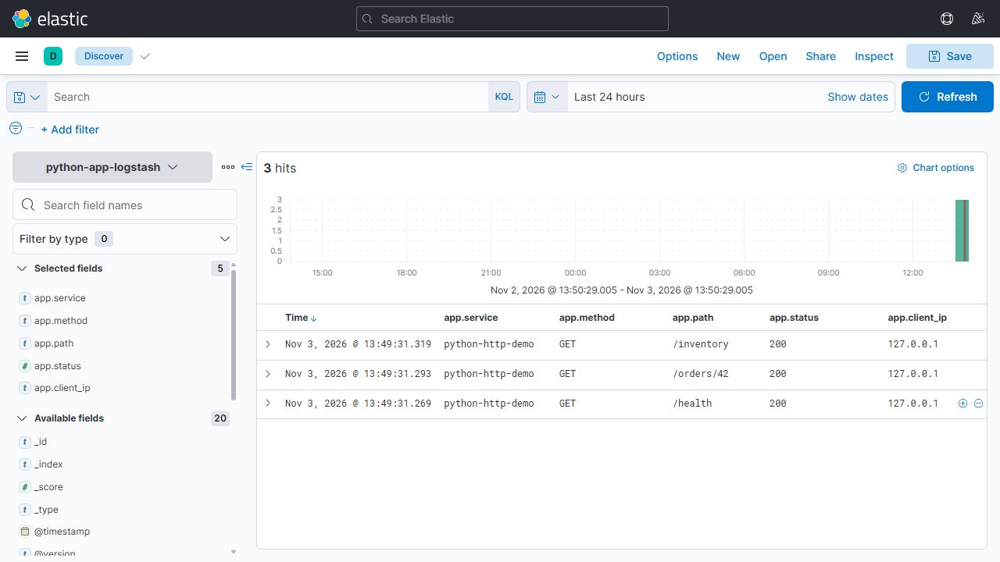

# Домашнее задание 11.03 «ELK» — Колесникова Анастасия

## Задание 1. Elasticsearch

## Задание 2. Kibana

## Задание 3. Logstash

## Задание 4. Filebeat

## Задание 5*. Доставка данных

Отправляется журнал HTTP-сервиса на Python (`http.server`). Сервис записывает обращения в `logs/app/access.jsonl`. Filebeat читает файл и передаёт записи в Logstash. JSON-фильтр Logstash выделяет поля `app.service`, `app.method`, `app.path`, `app.status`, `app.client_ip` и `app.timestamp`. События поступают в индекс `python-app-logstash`.

