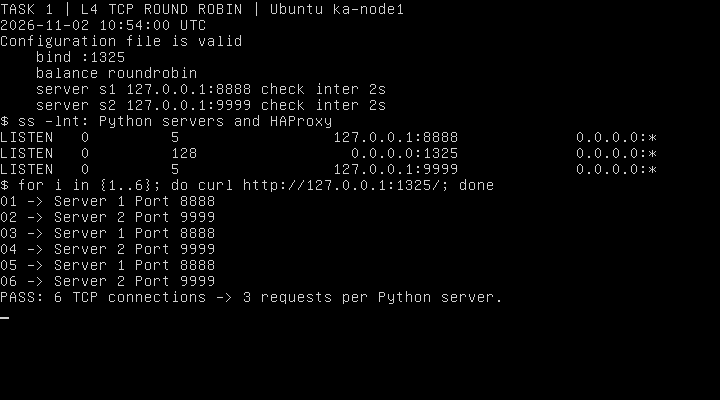
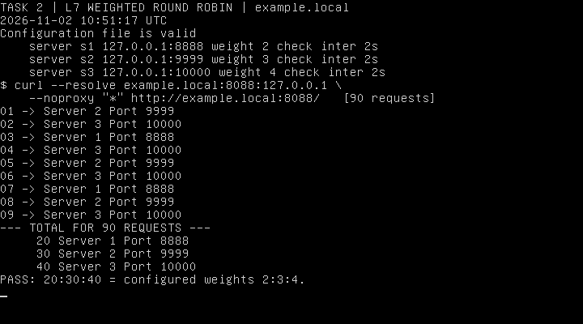
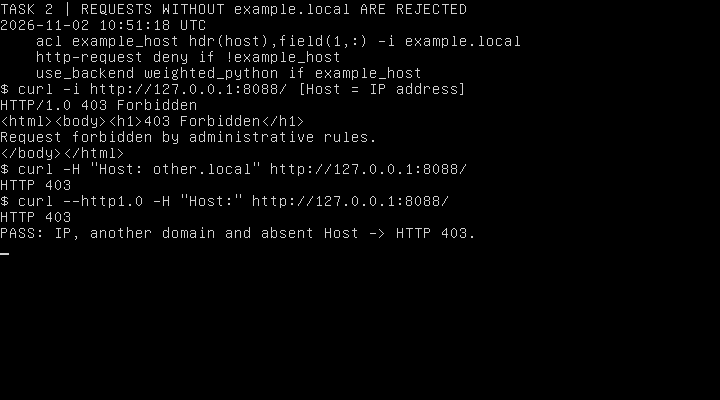
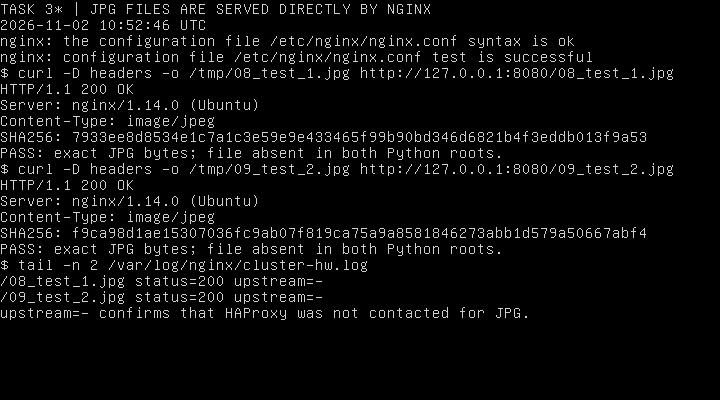
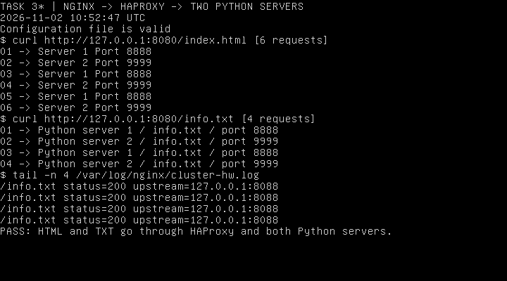
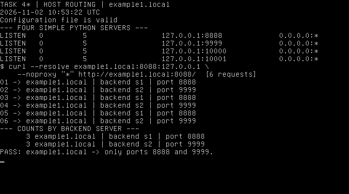
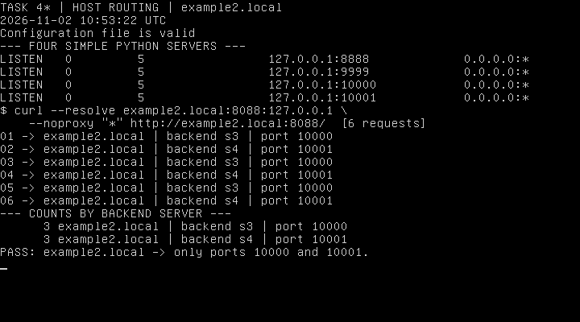

# Домашнее задание к занятию 2 «Кластеризация и балансировка нагрузки» — Колесникова Анастасия

[Условие задания](https://github.com/netology-code/sflt-homeworks/blob/main/2.md) · [Материалы лекции](https://github.com/netology-code/sflt-homeworks/tree/main/2)

Выполнены задания **1, 2, 3* и 4***. Использована локальная ВМ Ubuntu 18.04.6 LTS (`ka-node1`, адрес `192.168.56.41`). Установлены HAProxy 1.8.8-1ubuntu0.13, nginx 1.14.0 и Python 3.6.9.

Задания выполнялись последовательно: для каждого этапа соответствующий файл устанавливался как `/etc/haproxy/haproxy.cfg`, после проверки `haproxy -c -f /etc/haproxy/haproxy.cfg` служба перезапускалась. Поэтому приложены четыре отдельные полные конфигурации HAProxy и снимки результатов каждого этапа.

| Задание | Входная точка | Python-серверы | Балансировка |
| --- | --- | --- | --- |
| 1 | HAProxy `:1325` | `127.0.0.1:8888`, `:9999` | L4 TCP, Round Robin |
| 2 | HAProxy `:8088`, Host `example.local` | `:8888`, `:9999`, `:10000` | L7 HTTP, веса 2:3:4 |
| 3* | nginx `:8080` → HAProxy `127.0.0.1:8088` | `:8888`, `:9999` | JPG из nginx; остальные файлы через HAProxy |
| 4* | HAProxy `:8088`, два доменных имени | `:8888`, `:9999`, `:10000`, `:10001` | Выбор одного из двух бэкендов по Host |

## Подготовка Python-серверов

Использован стандартный модуль `http.server`, как в материалах лекции. У каждого сервера свой рабочий каталог `/srv/cluster-hw/<порт>` и файл `index.html`, позволяющий определить, какой сервер ответил. Процессы работают от пользователя `www-data`.

Приложены общие файлы для повторения запуска:

- [16_python-http@.service](16_python-http@.service) — шаблон службы, запускающей `/usr/bin/python3 -m http.server %i --bind 127.0.0.1` из каталога соответствующего порта.
- [17_start_python_servers.sh](17_start_python_servers.sh) — подготовка страниц и запуск двух, трёх или четырёх Python-серверов для выбранного задания. Скрипт также дожидается готовности HTTP-портов.

После копирования файлов в `/tmp` ВМ подготовка выполняется так:

```bash
sudo apt-get update
sudo apt-get install -y haproxy nginx python3 curl
sudo install -m 0644 /tmp/16_python-http@.service /etc/systemd/system/python-http@.service
sudo systemctl daemon-reload
```

Для каждого этапа запускается `sudo bash /tmp/17_start_python_servers.sh <номер задания>`, затем устанавливается его конфигурация HAProxy и перезапускается служба. Скрипт останавливает лишние экземпляры Python, поэтому число серверов соответствует текущему заданию.

## Задание 1. Round Robin на четвёртом уровне

**Полная конфигурация:** [01_haproxy_task1.cfg](01_haproxy_task1.cfg).

Запущены два Simple Python server на портах **8888** и **9999**. Их страницы содержат `Server 1 Port 8888` и `Server 2 Port 9999`. HAProxy принимает TCP-соединения на порту **1325**, работает в `mode tcp` и распределяет их алгоритмом `balance roundrobin` между двумя серверами с одинаковыми весами. HTTP-заголовки на этом этапе не используются для выбора сервера.

```bash
sudo bash /tmp/17_start_python_servers.sh 1
sudo install -m 0644 /tmp/01_haproxy_task1.cfg /etc/haproxy/haproxy.cfg
sudo haproxy -c -f /etc/haproxy/haproxy.cfg
sudo systemctl restart haproxy

for i in {1..6}; do
    curl --noproxy '*' http://127.0.0.1:1325/
done
```

Шесть отдельных запросов дали чередующиеся ответы двух серверов: **по три запроса на каждый**. На снимке видны действующая конфигурация, прослушиваемые порты и ответы через HAProxy.



## Задание 2. Weighted Round Robin и фильтрация домена

**Полная конфигурация:** [03_haproxy_task2.cfg](03_haproxy_task2.cfg).

Запущены три Python-сервера на портах **8888**, **9999**, **10000**. HAProxy принимает HTTP на порту **8088**. В бэкенде `weighted_python` используется `balance roundrobin` с весами **2**, **3**, **4** соответственно.

```text
acl example_host hdr(host),field(1,:) -i example.local
http-request deny if !example_host
use_backend weighted_python if example_host

server s1 127.0.0.1:8888 weight 2 check inter 2s
server s2 127.0.0.1:9999 weight 3 check inter 2s
server s3 127.0.0.1:10000 weight 4 check inter 2s
```

ACL проверяет имя в заголовке `Host`, без учёта регистра и необязательного номера порта. В бэкенд допускается только `example.local`; остальные запросы отклоняются с HTTP 403.

Проверка доменного имени выполнена командой `curl --resolve`, которая задаёт соответствие имени и IP только для конкретного запроса:

```bash
curl --noproxy '*' --resolve example.local:8088:127.0.0.1 \
    http://example.local:8088/
```

При выполнении **90 запросов** получено распределение:

| Сервер | Порт | Вес | Число ответов |
| --- | --- | --- | --- |
| s1 | 8888 | 2 | 20 |
| s2 | 9999 | 3 | 30 |
| s3 | 10000 | 4 | 40 |

Соотношение **20:30:40** соответствует заданным весам **2:3:4**. На снимке показаны первые девять ответов и итоговый подсчёт всех 90 запросов.



Отдельно проверены запрос по IP без нужного домена, запрос с другим доменом и HTTP/1.0-запрос без заголовка `Host`:

```bash
curl --noproxy '*' -i http://127.0.0.1:8088/
curl --noproxy '*' -H 'Host: other.local' http://127.0.0.1:8088/
curl --noproxy '*' --http1.0 -H 'Host:' http://127.0.0.1:8088/
```

Во всех трёх случаях получен **HTTP 403**, страницы Python-серверов не выдаются.



## Задание 3*. Связка nginx → HAProxy → Python

**Конфигурации:** [06_haproxy_task3.cfg](06_haproxy_task3.cfg), [07_nginx_task3.conf](07_nginx_task3.conf).

На этом этапе запущены два Python-сервера на портах **8888** и **9999**. HAProxy слушает **127.0.0.1:8088** и распределяет HTTP-запросы между ними по Round Robin. nginx принимает запросы на порту **8080**.

Две тестовые JPEG-картинки [08_test_1.jpg](08_test_1.jpg) и [09_test_2.jpg](09_test_2.jpg) размещены непосредственно в **`/var/www/`**. В nginx настроено:

```nginx
root /var/www;

location ~* \.jpg$ {
    try_files $uri =404;
}

location / {
    proxy_pass http://127.0.0.1:8088;
    proxy_set_header Host $host;
    proxy_set_header X-Real-IP $remote_addr;
    proxy_set_header X-Forwarded-For $proxy_add_x_forwarded_for;
}
```

Файл `07_nginx_task3.conf` установлен как `/etc/nginx/conf.d/cluster-hw.conf`, выполнены `sudo nginx -t` и `sudo systemctl reload nginx`.

### Запросы JPG

```bash
curl --noproxy '*' -D - -o /tmp/test1.jpg http://127.0.0.1:8080/08_test_1.jpg
curl --noproxy '*' -D - -o /tmp/test2.jpg http://127.0.0.1:8080/09_test_2.jpg
```

Оба файла вернулись с **HTTP 200** и `Content-Type: image/jpeg`. Загруженные байты совпали с исходными файлами в `/var/www/`, что проверено `cmp` и SHA256. В каталогах обоих Python-серверов этих картинок нет.

В журнал nginx добавлено поле `$upstream_addr`. Для JPG записано **`upstream=-`**: nginx выдал файлы самостоятельно, не обращаясь к HAProxy.



### Запросы HTML и TXT

```bash
curl --noproxy '*' http://127.0.0.1:8080/index.html
curl --noproxy '*' http://127.0.0.1:8080/info.txt
```

Ответы на `index.html` и `info.txt` чередуются между первым и вторым Python-серверами. Шесть запросов `index.html` распределились поровну, по три на сервер. В журнале nginx для этих запросов указан **`upstream=127.0.0.1:8088`**, то есть запрос прошёл через HAProxy.



## Задание 4*. Два сайта и два бэкенда HAProxy

**Полная конфигурация:** [12_haproxy_task4.cfg](12_haproxy_task4.cfg).

Запущены четыре Simple Python server на разных портах. В `index.html` первых двух указано `example1.local`, вторых двух — `example2.local`. Дополнительно в странице указаны имя сервера и порт, чтобы по ответу было видно, какой экземпляр его обработал.

| Сайт | Бэкенд HAProxy | Серверы |
| --- | --- | --- |
| example1.local | example1_servers | s1 — 8888, s2 — 9999 |
| example2.local | example2_servers | s3 — 10000, s4 — 10001 |

Один фронтенд `virtual_hosts` слушает порт **8088** и направляет запросы в один из двух бэкендов по имени сайта:

```text
acl site1 hdr(host),field(1,:) -i example1.local
acl site2 hdr(host),field(1,:) -i example2.local
http-request deny if !site1 !site2
use_backend example1_servers if site1
use_backend example2_servers if site2
```

Внутри каждого бэкенда настроен `balance roundrobin` между его двумя серверами.

### Проверка example1.local

```bash
curl --noproxy '*' --resolve example1.local:8088:127.0.0.1 \
    http://example1.local:8088/
```

Шесть запросов вернули только страницы **example1.local** от **s1:8888** и **s2:9999**, по три ответа от каждого сервера.



### Проверка example2.local

```bash
curl --noproxy '*' --resolve example2.local:8088:127.0.0.1 \
    http://example2.local:8088/
```

Шесть запросов вернули только страницы **example2.local** от **s3:10000** и **s4:10001**, по три ответа от каждого сервера.



## Проверка и завершение

Все четыре файла HAProxy проверены командой `haproxy -c -f`, конфигурация nginx — `nginx -t`, Bash-скрипт запуска — `bash -n`. Контрольные суммы конфигурации последнего этапа, конфигурации nginx, двух JPG, шаблона службы Python и скрипта совпадают с установленными в ВМ файлами.

Скриншоты показывают реальные запросы `curl` и их результаты в консоли учебной ВМ. После выполнения всех заданий **ВМ выключена**.

Использованная документация: [HAProxy: конфигурация и балансировка](https://docs.haproxy.org/1.8/configuration.html), [nginx: proxy_pass](https://nginx.org/en/docs/http/ngx_http_proxy_module.html#proxy_pass), [Python: http.server](https://docs.python.org/3/library/http.server.html).
