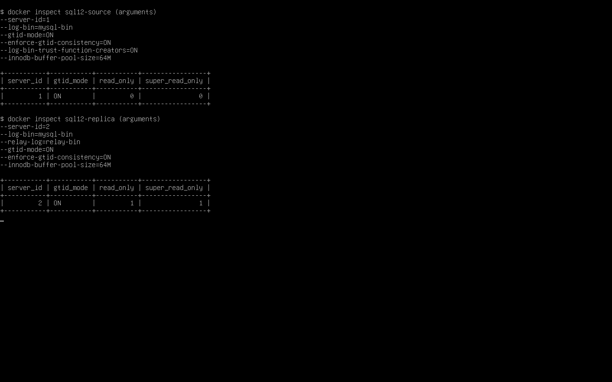
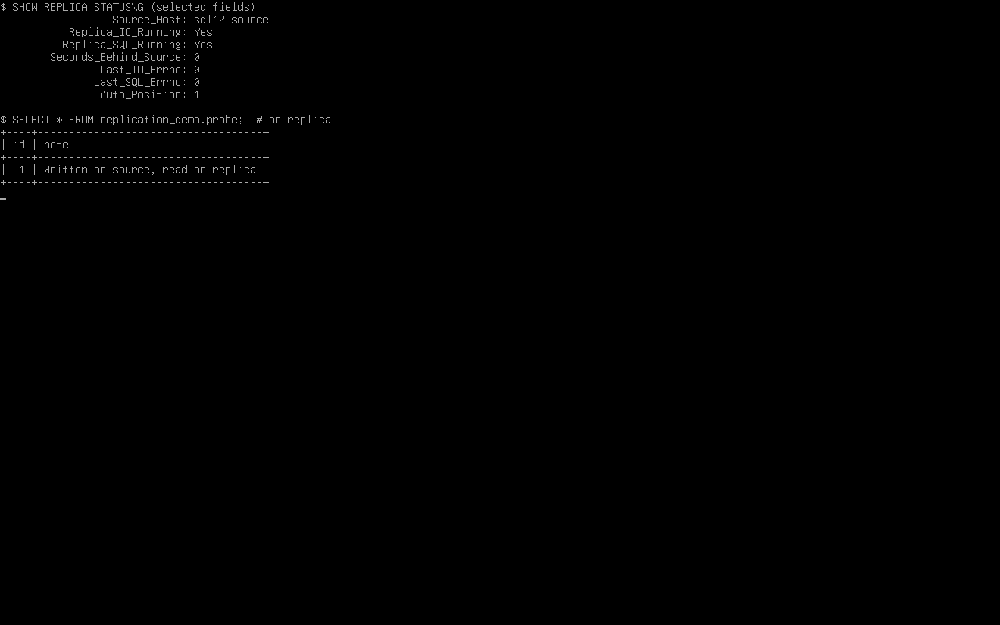
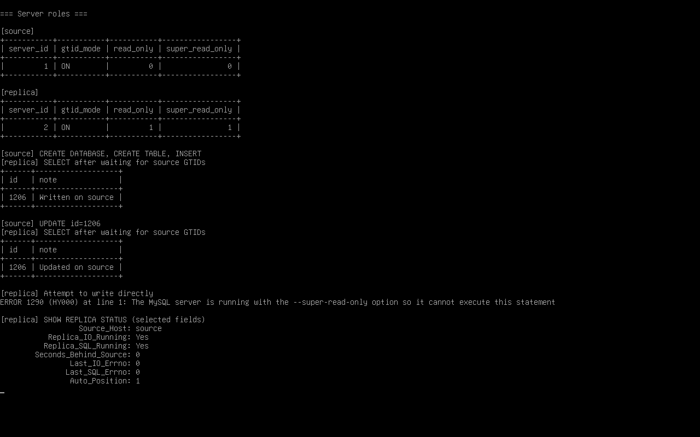
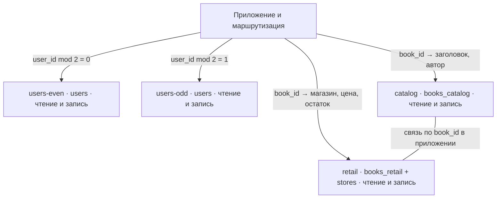

# Домашнее задание 12.06 «Репликация и масштабирование» — Колесникова Анастасия

## Задание 1. Репликация MySQL

Настроена однонаправленная асинхронная репликация MySQL 8.0.46 в закрытой сети Docker. Источник `source` принимает запись и сохраняет изменения в binlog. Реплика `replica` получает и применяет транзакции по GTID и работает в режиме `super_read_only=ON`.

| Узел | server_id | GTID | read_only | super_read_only |
|---|---:|---|---:|---:|
| Источник | 1 | ON | 0 | 0 |
| Реплика | 2 | ON | 1 | 1 |

**Конфигурация.** [Docker Compose](replication/compose.yaml) · [MySQL источника](replication/source.cnf) · [MySQL реплики](replication/replica.cnf)



**Настройка канала.** На источнике создан пользователь репликации с правом `REPLICATION SLAVE`. На реплике выполнены команды ниже. Скрипт подставляет сгенерированный пароль автоматически.

```sql
SET PERSIST super_read_only = ON;
CHANGE REPLICATION SOURCE TO
  SOURCE_HOST = 'source',
  SOURCE_USER = 'replicator',
  SOURCE_PASSWORD = '<пароль пользователя репликации>',
  SOURCE_AUTO_POSITION = 1,
  GET_SOURCE_PUBLIC_KEY = 1;
START REPLICA;
SHOW REPLICA STATUS\G
```



**Проверка.** На источнике создана таблица и добавлена строка `id=1206`. После применения GTID реплика вернула `Written on source`. Затем на источнике выполнен `UPDATE`, и реплика вернула `Updated on source`. Прямая попытка записи на реплике отклонена с `ERROR 1290`. В статусе оба потока показывают `Yes`, коды ошибок равны `0`.



[Фактический текстовый вывод проверки](replication/verification.txt) · [Скрипт развёртывания и проверки](replication/verify.sh)

**Запуск на чистых томах.** Из каталога `replication` выполните команды ниже. Нужны Docker Compose, Bash и OpenSSL. При необходимости запускайте Docker с правами администратора.

```bash
export MYSQL_ROOT_PASSWORD="$(openssl rand -hex 20)"
bash verify.sh
```

## Задание 2. План шардирования



Горизонтально делю таблицу `users` на два шарда с одинаковой схемой. Чтение или запись конкретного пользователя направляется по остатку от деления `user_id` на 2. Глобальные отчёты читают оба шарда, затем объединяют результаты. Идентификаторы выделяются до маршрутизации.

Вертикально делю `books` по столбцам. Название и автор хранятся на `catalog`, а магазин, цена и остаток — на `retail`. Общий ключ `book_id` позволяет приложению собрать полную карточку. Таблица `stores` хранится на `retail`, где внешний ключ проверяет связь с магазином. Учебная модель допускает один магазин на книгу. Все четыре сервера работают в режиме чтения и записи для своих данных. Изменения, затрагивающие две БД, координирует приложение с повторяемыми операциями и сверкой.


## Задание 3*. Методы масштабирования

| Метод | Что даёт | Как работает при отказе |
|---|---|---|
| Активный основной сервер и пассивная реплика | Пассивный узел получает изменения и держит готовую копию, что уменьшает время восстановления. Нагрузка приложений идёт на основной сервер. | После проверки отставания и изоляции старого узла реплику продвигают в основной. При асинхронной репликации возможна потеря последних записей. |
| Основной сервер и несколько реплик | Отчёты и запросы на чтение можно распределить между репликами. Резервные копии можно снимать с отдельной реплики. | Есть выбор узла для продвижения. Запись по-прежнему идёт через один основной сервер. Для чтения сразу после записи нужно учитывать задержку репликации. |
| Активный сервер и DRBD | DRBD реплицирует блоки диска между серверами. В синхронном режиме Protocol C запись подтверждается после записи на обоих узлах, что снижает риск потери подтверждённых изменений. | После изоляции старого узла резервный продвигается, монтирует устройство и запускает СУБД с обычным восстановлением журнала. |
| SAN-кластер | Серверы могут подключаться к одному отказоустойчивому блочному хранилищу. При отказе сервера резервному доступен тот же том, а multipath снижает зависимость от одного пути к хранилищу. | Менеджер кластера изолирует старый узел и передаёт том резервному. Одновременный доступ требует поддержки кластерной ФС и согласованной блокировки. |

[Руководство LINBIT по DRBD](https://linbit.com/drbd-user-guide/drbd-guide-9_0-en/)


## Задание 4*. Настройка шардирования

[Конфигурация Docker Compose](sharding/compose.yaml)

SQL-скрипты инициализации по узлам — [users-even](sharding/sql/users-even.sql), [users-odd](sharding/sql/users-odd.sql), [catalog](sharding/sql/catalog.sql), [retail](sharding/sql/retail.sql).

[Результат проверки на четырёх запущенных серверах MySQL](sharding-results.txt)
