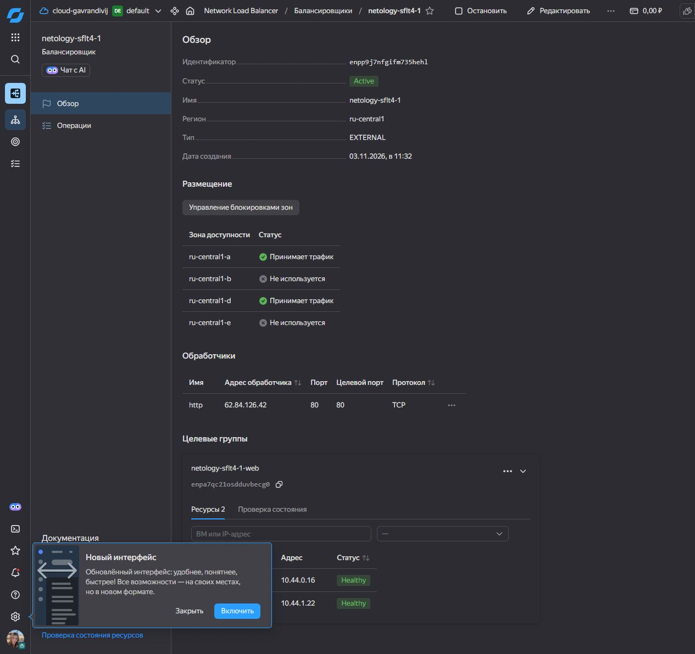
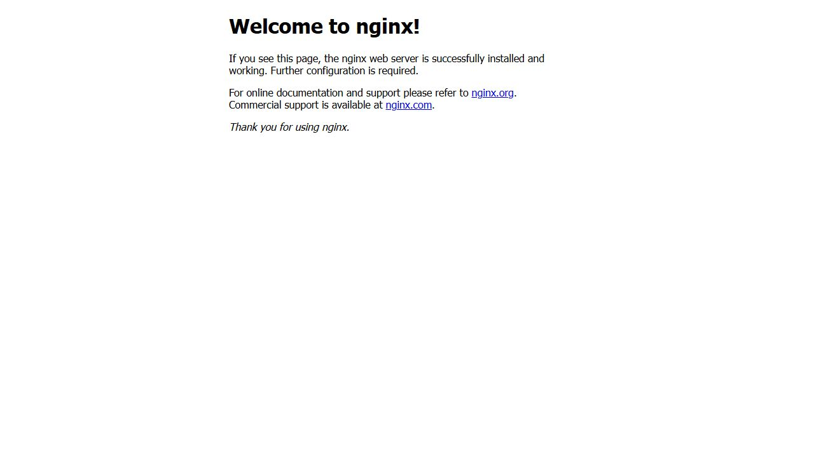
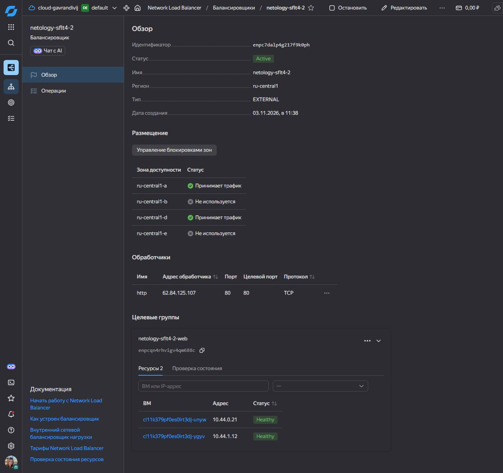

# Отказоустойчивость в облаке — Колесникова Анастасия

Домашнее задание к занятию 4. [Условие задания](https://github.com/netology-code/sflt-homeworks/blob/main/4.md)

Для каждого задания используется отдельная конфигурация Terraform. В обеих Ubuntu 22.04 развёртывается в зонах `ru-central1-a` и `ru-central1-d`. Для веб-трафика внешний Network Load Balancer слушает TCP-порт 80 и направляет запросы на порт 80 целевых ВМ. Проверка состояния выполняет HTTP GET `/` на порту 80.

## Задание 1. Две ВМ через count

Ресурс `yandex_compute_instance.web` с `count = 2` создаёт две ВМ с одинаковыми параметрами, по одной в каждой зоне. Ресурс `yandex_lb_target_group.web` регистрирует их внутренние IP-адреса. Nginx устанавливается при загрузке каждой ВМ через cloud-init. [Terraform](01-count/main.tf) · [Cloud-init](01-count/cloud-init.yaml)

Балансировщик `netology-sflt4-1` в состоянии `Active`. Цели `10.44.0.16` и `10.44.1.22` в состоянии `Healthy`.



Запрос по адресу `http://62.84.126.42/` вернул HTTP 200 и стандартную страницу Nginx.



## Задание 2 со звёздочкой. Группа ВМ с балансировщиком

Ресурс `yandex_compute_instance_group.web` поддерживает два экземпляра. Группа управляет целевой группой, которую Terraform подключает к внешнему балансировщику. Файл cloud-init передаётся в метаданные через `user-data`, устанавливает Nginx из пакета и запускает службу. [Terraform](02-instance-group/main.tf) · [Cloud-init](02-instance-group/cloud-init.yaml)

Балансировщик `netology-sflt4-2` в состоянии `Active`. Цели `10.44.0.21` и `10.44.1.12` в состоянии `Healthy`.



Запрос по адресу `http://62.84.125.107/` вернул HTTP 200 и стандартную страницу Nginx.


## Как повторить

В каталоге выбранного задания скопировать `terraform.tfvars.example` в `terraform.tfvars` и заполнить переменные. Для второго задания указать сервисный аккаунт группы с правами управления Compute Cloud и Network Load Balancer в том же каталоге. Учетные данные провайдера передаются через переменные окружения, например `YC_SERVICE_ACCOUNT_KEY_FILE`. [Права доступа Instance Groups](https://yandex.cloud/ru/docs/compute/concepts/instance-groups/access)

```bash
terraform init
terraform validate
terraform plan
terraform apply
terraform output -raw balancer_ip
```

В консоли открыть обзор балансировщика и раскрыть целевую группу. После перехода обеих целей в `Healthy` открыть `http://<balancer_ip>/`. [Документация Network Load Balancer](https://yandex.cloud/ru/docs/network-load-balancer/quickstart)
