# Домашнее задание к занятию 1 «Disaster recovery и Keepalived» — Колесникова Анастасия

[Условие домашнего задания](https://github.com/netology-code/sflt-homeworks/blob/main/1.md)

## Задание 1. Отслеживание Gi0/0 для первой группы HSRP

Использована исходная схема `hsrp_advanced.pkt` из задания. На обоих маршрутизаторах на интерфейсе Gi0/1 настроено отслеживание Gi0/0 для группы 1.

На схеме устройства называются **Router1** и **Router2**, а их исходные имена в приглашении IOS — `Router0` и `Router1` соответственно.

На Router1 выполнены команды:

```text
enable
configure terminal
interface gigabitethernet0/1
standby 1 track gigabitethernet0/0
standby 1 priority 95
standby 1 preempt
end
write memory
```

На Router2 выполнены команды:

```text
enable
configure terminal
interface gigabitethernet0/1
standby 1 track gigabitethernet0/0
end
write memory
```

В установленном Packet Tracer команда отслеживания интерфейса использует уменьшение приоритета на 10 и не принимает отдельное значение уменьшения. Поэтому для группы 1 на резервном Router1 установлен приоритет 95 и включён `preempt`. У Router2 приоритет равен 100. При обрыве Gi0/0 его приоритет становится 90, и Router1 с приоритетом 95 принимает активную роль.

**Готовая схема:** [01_HSRP_Gi0-0.pkt](01_HSRP_Gi0-0.pkt).

Процесс настройки Router2 и результат команды `show standby gigabitethernet0/1`:

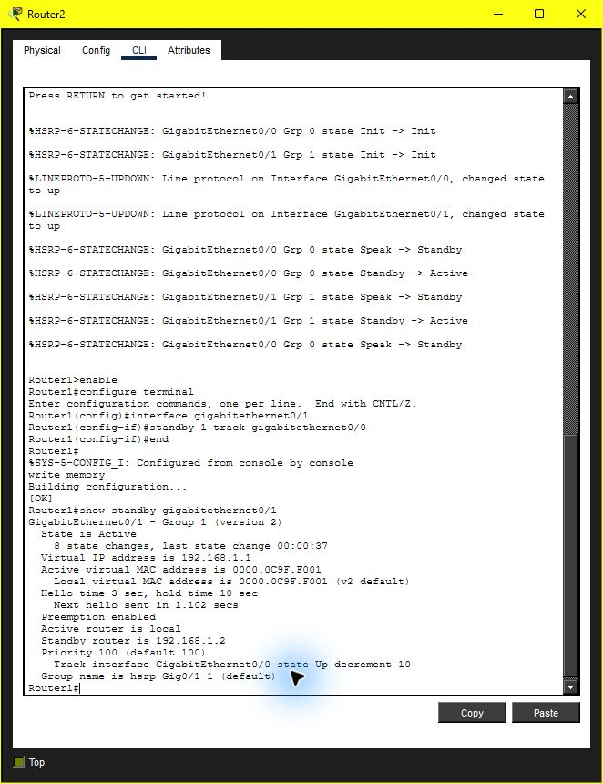

Для проверки удалён кабель между Router2 и Switch0. С PC0 (`192.168.0.250`) выполнен `ping 192.168.1.50` на Server0. Первый запуск получил три ответа из четырёх; повторный — четыре ответа из четырёх, потерь 0%. На скриншоте одновременно видны разорванное соединение и результат ping.

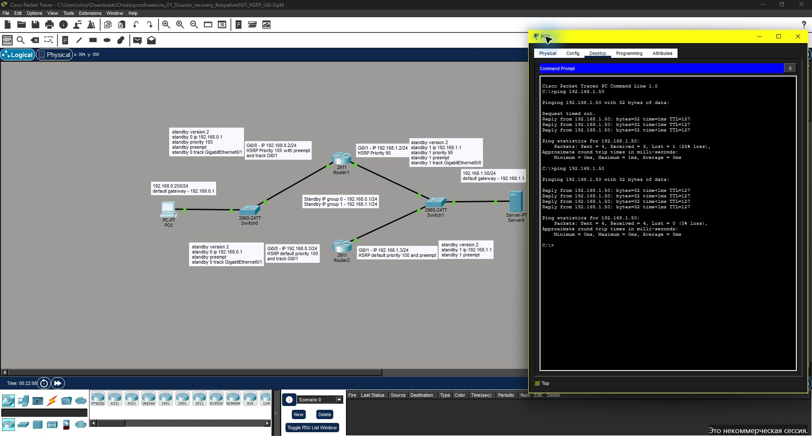

На Router2 команда `show standby gigabitethernet0/1` показывает состояние `Standby`, приоритет 90 и активный маршрутизатор `192.168.1.2` с приоритетом 95. Команда `show ip interface brief` подтверждает состояние `down/down` у Gi0/0.

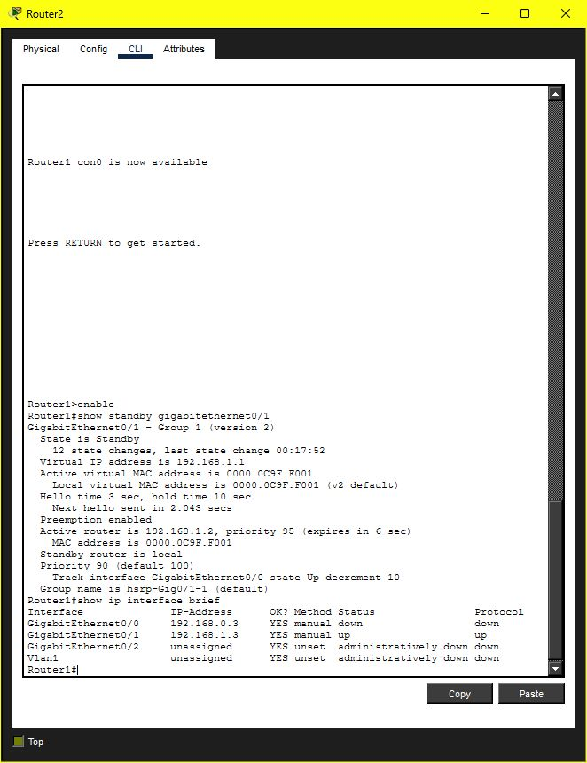

После проверки кабель восстановлен, итоговый файл `.pkt` сохранён с рабочими соединениями и настроенным отслеживанием.

## Задание 2. Keepalived и проверка веб-сервера

Развёрнуты две локальные ВМ Ubuntu 18.04.6 LTS на основе одного образа. На обеих установлены nginx 1.14.0 и Keepalived 1.3.9.

| Параметр | ka-node1 | ka-node2 |
| --- | --- | --- |
| Постоянный адрес | `192.168.56.41/24` | `192.168.56.42/24` |
| Интерфейс локальной сети | `enp0s8` | `enp0s8` |
| Исходное состояние Keepalived | `MASTER` | `BACKUP` |
| Приоритет | `255` | `200` |
| Корневая директория nginx | `/var/www/html` | `/var/www/html` |

Общий виртуальный IP — **`192.168.56.45/24`**, `virtual_router_id` — **15**. Конфигурации подготовлены на основе [примера из лекции](https://github.com/netology-code/sflt-homeworks/blob/main/1/keepalived-simple.conf). В `index.html` каждого узла указано его имя, поэтому HTTP-ответ позволяет определить обслуживающий сервер.

### Bash-скрипт

Файл [05_check_web.sh](05_check_web.sh) установлен на обеих ВМ как `/usr/local/bin/check_web.sh`, принадлежит `root` и имеет права `0755`.

```bash
#!/bin/bash

[[ -f /var/www/html/index.html ]] || exit 1

/usr/bin/timeout 1 /bin/bash -c 'exec 3<>/dev/tcp/127.0.0.1/80' \
    >/dev/null 2>&1 || exit 1

exit 0
```

Скрипт проверяет наличие `index.html` и устанавливает TCP-соединение с портом 80 локального nginx. При любой неудачной проверке он возвращает код 1, при успехе — 0.

### Конфигурации Keepalived

- [06_keepalived_node1.conf](06_keepalived_node1.conf) — конфигурация основного сервера.
- [07_keepalived_node2.conf](07_keepalived_node2.conf) — конфигурация резервного сервера.

Каждый файл установлен на соответствующей ВМ по пути `/etc/keepalived/keepalived.conf`. Проверка подключена через `vrrp_script` и `track_script`:

```text
vrrp_script check_web {
    script "/usr/local/bin/check_web.sh"
    interval 3
    timeout 2
    fall 1
    rise 1
    weight 0
}
```

Интервал запуска — 3 секунды. При ненулевом коде проверки узел переходит в `FAULT` и освобождает виртуальный IP. Для возврата к работе достаточно одной успешной проверки. Обе службы включены в автозагрузку.

### Проверка отказа порта nginx

До отказа VIP принадлежал `ka-node1`, HTTP-запрос по VIP возвращал страницу `ka-node1`. На первом сервере выполнена команда `systemctl stop nginx`. Скрипт завершился с кодом 1, Keepalived перешёл в `FAULT`, адрес исчез с первого сервера. Через семь секунд HTTP-запрос к тому же VIP вернул страницу `ka-node2`.

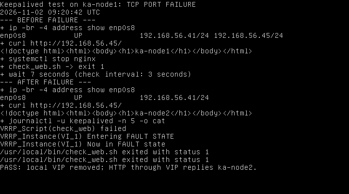

На втором сервере подтверждены наличие VIP `192.168.56.45/24`, успешная проверка веб-сервера и переход в `MASTER`.

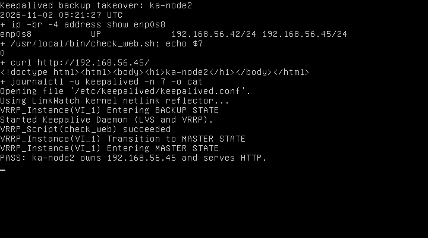

### Проверка отсутствия index.html

После запуска nginx и возврата VIP на первый сервер файл `/var/www/html/index.html` временно переименован в `index.html.hw-backup`. Порт 80 при этом оставался открыт. Проверочный скрипт вернул код 1, первый сервер перешёл в `FAULT`, а запрос по VIP стал обслуживать второй сервер.

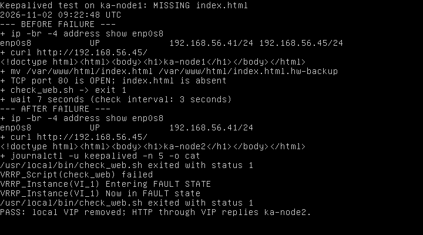

На `ka-node2` повторно подтверждены виртуальный IP, состояние `MASTER` и доступность сайта.

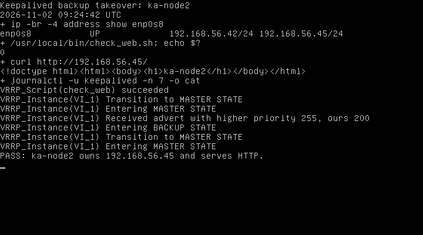

После проверок восстановлены nginx и исходный `index.html`. VIP вернулся на `ka-node1`, сайт снова отдаёт его страницу. По завершении работы обе учебные ВМ выключены.

## Дополнительное задание 3*

### Отслеживание файла и расчёт приоритета

Выполнено на трёх локальных ВМ: `ka-node1` — `192.168.56.41`, `ka-node2` — `192.168.56.42`, `ka-node3` — `192.168.56.43`. У каждой ВМ один vCPU; на каждой работают nginx и Keepalived. Общий VIP сохранён: `192.168.56.45/24`, интерфейс — `enp0s8`, VRID — 15.

Для этого задания установлен **Keepalived 2.2.8**, собранный из [официального исходного архива](https://www.keepalived.org/software/keepalived-2.2.8.tar.gz): в использованном ранее пакете 1.3.9 отсутствует `vrrp_track_file`. Сборка выполнена с параметрами `--prefix=/usr/local --sysconfdir=/etc --disable-lvs --disable-bfd`; бинарный файл установлен как `/usr/local/sbin/keepalived`.

По [документации Keepalived](https://www.keepalived.org/documentation/keepalived-conf/), значение отслеживаемого файла умножается на его вес и прибавляется к базовому приоритету. На всех трёх узлах установлен одинаковый базовый приоритет **200**, начальное состояние `BACKUP`, вытеснение включено по умолчанию. Приоритет 255 здесь не используется: он обозначает владельца адреса и не подходит для уменьшения приоритета по нагрузке.

Скрипт [13_update_load_priority.sh](13_update_load_priority.sh) читает минутный Load average из `/proc/loadavg`, делит его на число процессоров и записывает поправку в `/var/lib/keepalived/load_priority`:

```text
L = load_average_1min / online_cpus
поправка = -min(190, round(40 × L))
эффективный приоритет = 200 + поправка
```

Чем ниже нормированная нагрузка, тем выше приоритет. Одинаковая формула используется для двух и трёх серверов, поэтому добавление третьего узла не создаёт для него постоянного преимущества. Диапазон эффективного приоритета — 10–200. Из-за целочисленных приоритетов близкие значения нагрузки могут дать одинаковый результат; тогда VRRP использует правило разрешения равенства по IP. После насыщения формулы при `L >= 4.7375` приоритет равен 10. Выбор производится по последнему минутному измерению, с задержкой выборов VRRP; это не мгновенная реакция на изменение CPU. Во всех приведённых проверках наименее нагруженный узел имел однозначно наивысший приоритет; в последней проверке сильно нагруженный третий узел достиг нижнего ограничения 10.

Скрипт установлен на всех узлах как `/usr/local/bin/update_load_priority.sh`, `root:root`, `0755`. Запись защищена `flock`, результат каждого расчёта сохраняется в журнал с тегом `keepalived-load`. Файл [17_keepalived-load.cron](17_keepalived-load.cron) установлен в `/etc/cron.d/keepalived-load` и запускает скрипт каждую минуту:

```cron
* * * * * root /usr/local/bin/update_load_priority.sh
```

Скрипт также выполняется перед запуском службы, поэтому отслеживаемый файл существует уже при чтении конфигурации. Служба [18_keepalived-load.service](18_keepalived-load.service) запускает новый бинарный файл с конфигурацией `/etc/keepalived/keepalived-load.conf`. Прежняя служба `keepalived.service` остановлена и отключена, чтобы два процесса не управляли одним VIP.

### Конфигурации трёх серверов

- [14_keepalived_load_node1.conf](14_keepalived_load_node1.conf).
- [15_keepalived_load_node2.conf](15_keepalived_load_node2.conf).
- [16_keepalived_load_node3.conf](16_keepalived_load_node3.conf).

В каждой конфигурации задано отслеживание файла:

```text
vrrp_track_file load_priority {
    file /var/lib/keepalived/load_priority
    weight 1
}

vrrp_instance VI_1 {
    state BACKUP
    interface enp0s8
    virtual_router_id 15
    priority 200
    advert_int 1
    virtual_ipaddress {
        192.168.56.45/24
    }
    track_script {
        check_web
    }
    track_file {
        load_priority
    }
}
```

В полных файлах также сохранена проверка порта nginx и `index.html` через `vrrp_script check_web` каждые три секунды. Конфигурации проверены командой `/usr/local/sbin/keepalived --config-test --use-file=/etc/keepalived/keepalived-load.conf`; скрипт — командой `bash -n`. Контрольные суммы установленных файлов совпадают с приложенными файлами.

### Проверка двух серверов: нагрузка на MASTER

На первом этапе служба Keepalived третьего узла ещё не запущена. Исходный MASTER — `ka-node1`, VIP находится на нём, HTTP-запрос возвращает страницу `ka-node1`.

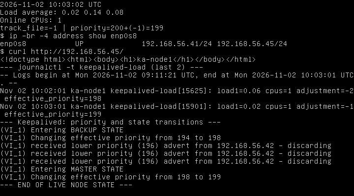

На `ka-node1` создана реальная нагрузка командой:

```bash
sudo systemd-run --unit=hw-load /usr/bin/stress --cpu 4 --timeout 600s
```

После очередного запуска cron журнал показал следующие расчёты:

| Узел | Load average за минуту | Поправка | Эффективный приоритет | Результат |
| --- | --- | --- | --- | --- |
| ka-node1 | 2.69 | -108 | 92 | BACKUP, VIP освобождён |
| ka-node2 | 0.94 | -38 | 162 | MASTER, VIP принят |

У `ka-node1` в журнале видно изменение приоритета `199 -> 92`, получение объявления от `192.168.56.42` с приоритетом 162 и переход в `BACKUP STATE`. Адрес `.45` исчез с интерфейса первого узла, HTTP через VIP возвращает `ka-node2`.

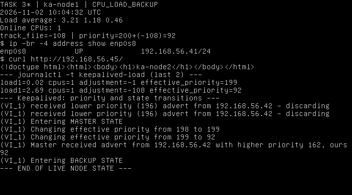

На втором узле видны `Entering MASTER STATE`, адрес `.45` и ответ его nginx:

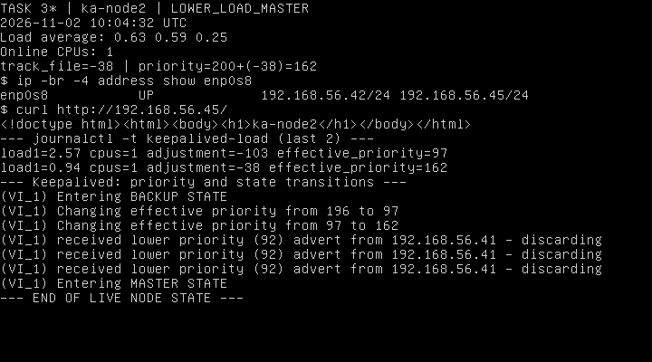

### Проверка трёх серверов с разной нагрузкой

Нагрузка первого узла оставлена работающей. На втором запущен `stress --cpu 2 --timeout 600s`, затем к VRRP подключён третий узел без искусственной нагрузки. Последние расчёты на момент проверки:

| Узел | Load average за минуту | Поправка | Эффективный приоритет | VIP |
| --- | --- | --- | --- | --- |
| ka-node1 | 3.52 | -141 | 59 | Нет |
| ka-node2 | 1.33 | -53 | 147 | Нет |
| ka-node3 | 0.10 | -4 | 196 | Да |

Минимальная нагрузка была у `ka-node3`; он получил максимальный приоритет и VIP. В журнале второго узла видно получение объявления от `.43` с приоритетом 196 и переход в `BACKUP`. На всех трёх узлах HTTP-запрос по общему VIP возвращает страницу `ka-node3`.

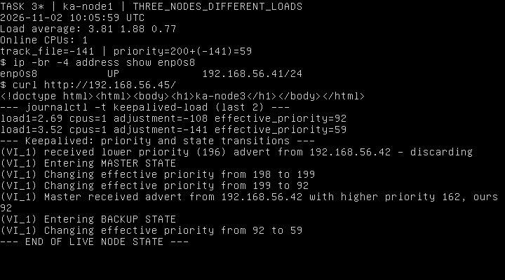

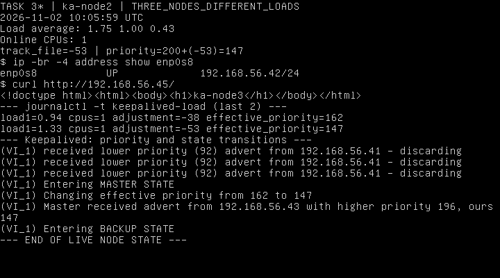

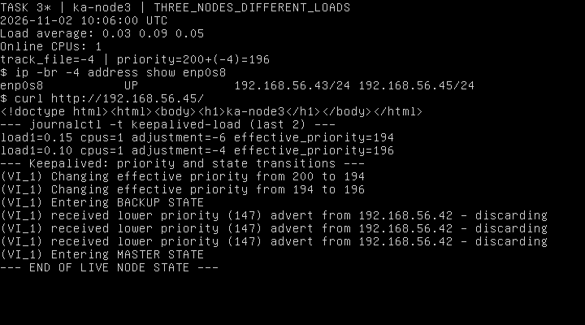

### Повторная смена MASTER при нагрузке третьего сервера

После получения VIP на `ka-node3` запущен генератор `stress --cpu 6 --timeout 600s`. На первых двух узлах сохранены нагрузки из предыдущего этапа. В следующем минутном расчёте приоритет третьего узла снизился `199 -> 45`, и он получил объявление от второго узла с более высоким приоритетом 121. В журнале виден переход `ka-node3` в `BACKUP STATE`; `ka-node2` снова перешёл в `MASTER STATE`.

На момент итоговых скриншотов следующий запуск cron уже обновил значения:

| Узел | Последний Load average в журнале расчёта | Поправка | Эффективный приоритет | VIP |
| --- | --- | --- | --- | --- |
| ka-node1 | 3.98 | -159 | 41 | Нет |
| ka-node2 | 1.99 | -80 | 120 | Да |
| ka-node3 | 5.22 | -190 | 10 | Нет |

VIP находится на втором сервере с наименьшей нагрузкой. Это подтверждается списком адресов интерфейса и HTTP-ответом `ka-node2` при запросе общего VIP со всех узлов. В таблицах указаны значения последнего расчёта из журнала `keepalived-load`: строка текущего `/proc/loadavg` на скриншоте может отличаться, поскольку нагрузка меняется между минутными запусками cron.

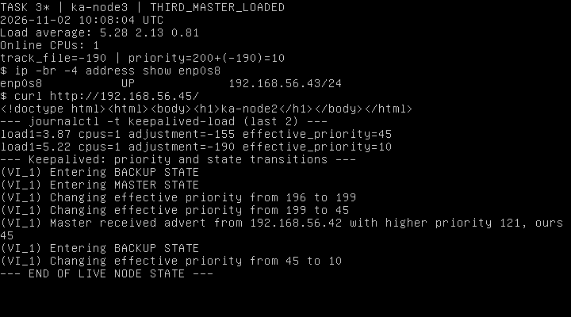

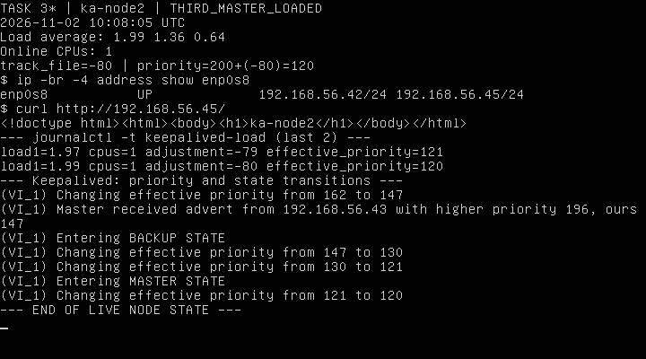

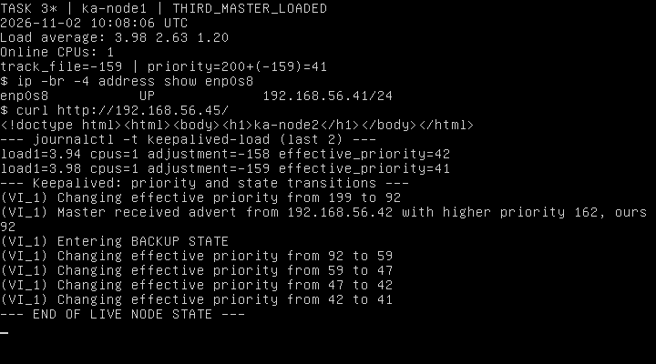

После испытаний все процессы `stress` остановлены. Проверка веб-сервера завершилась успешно на всех трёх узлах.
