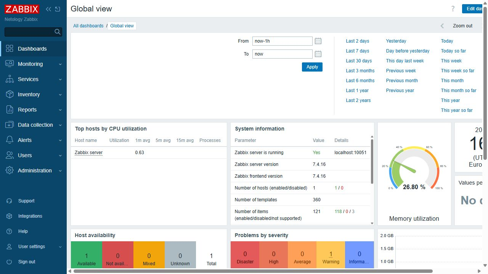
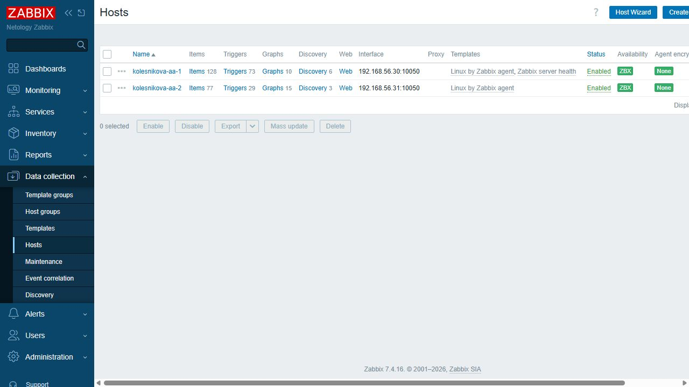
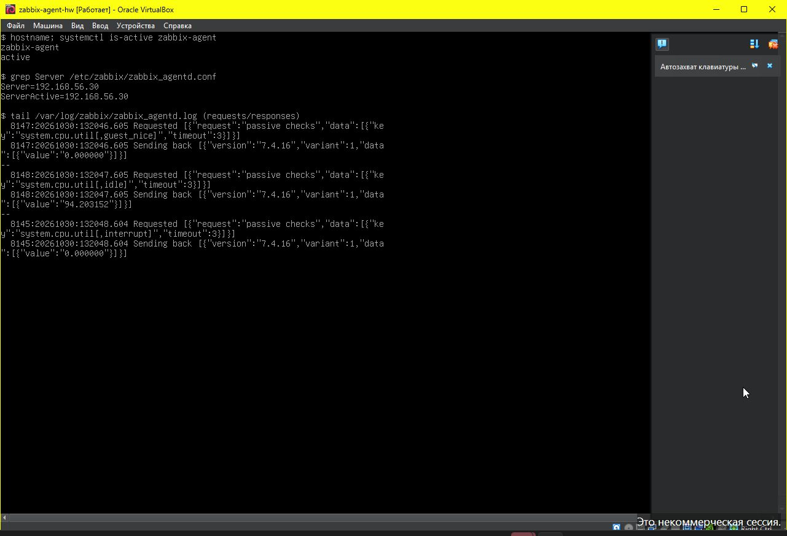
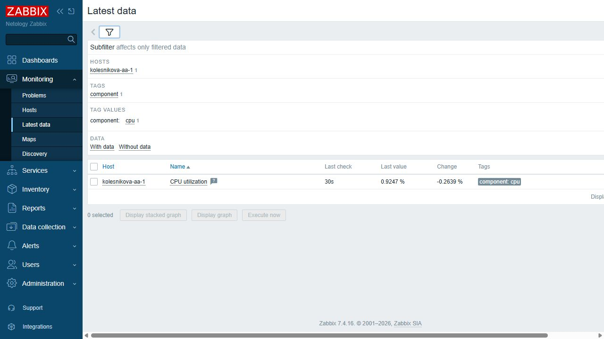
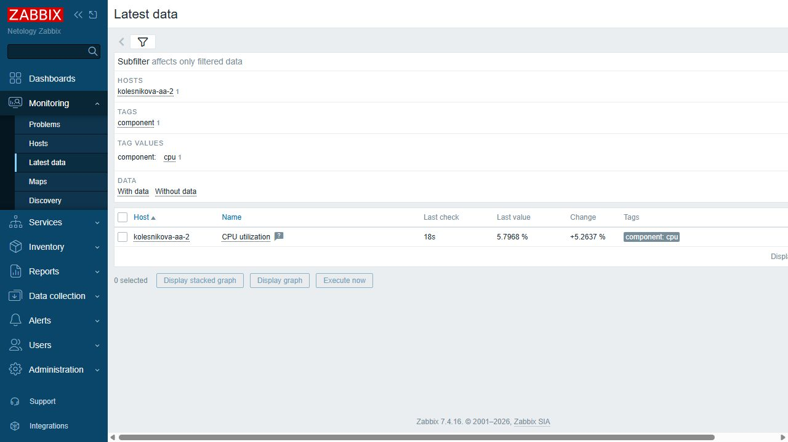

# Домашнее задание к занятию «Система мониторинга Zabbix» — Колесникова Анастасия

[Условие домашнего задания](https://github.com/netology-code/smon-homeworks/blob/main/hw-02.md)

## Задание 1. Установка Zabbix Server с веб-интерфейсом

На локальной виртуальной машине Debian 12 установлены PostgreSQL 15.19, Zabbix Server 7.4.16 и веб-интерфейс Zabbix под Apache 2.4.68. Пакеты Zabbix установлены из официального репозитория по командам [конфигуратора Zabbix для Debian 12, PostgreSQL и Apache](https://www.zabbix.com/download?zabbix=7.4&os_distribution=debian&os_version=12&components=server_frontend_agent&db=pgsql&ws=apache).

Созданы пользователь и база данных `zabbix`, импортирована начальная схема, настроено подключение сервера и веб-интерфейса к PostgreSQL. Службы `postgresql`, `zabbix-server`, `zabbix-agent` и `apache2` запущены и включены в автозагрузку.

Использованные команды приведены ниже. Они выполнялись от `root` на новой серверной ВМ. Пароль базы данных генерируется при установке и не включён в репозиторий.

```bash
#!/bin/bash
set -euo pipefail
export DEBIAN_FRONTEND=noninteractive
apt-get update
apt-get install -y postgresql curl ca-certificates wget locales
sed -i 's/^# en_US.UTF-8 UTF-8/en_US.UTF-8 UTF-8/' /etc/locale.gen
locale-gen
cd /tmp
wget -q https://repo.zabbix.com/zabbix/7.4/release/debian/pool/main/z/zabbix-release/zabbix-release_latest_7.4+debian12_all.deb
dpkg -i zabbix-release_latest_7.4+debian12_all.deb
apt-get update
apt-get install -y zabbix-server-pgsql zabbix-frontend-php php8.2-pgsql zabbix-apache-conf zabbix-sql-scripts zabbix-agent zabbix-get
systemctl enable --now postgresql
DB_PASSWORD=$(openssl rand -hex 18)
printf '%s\n' "$DB_PASSWORD" > /root/zabbix-db-password
chmod 600 /root/zabbix-db-password
sudo -u postgres psql -v ON_ERROR_STOP=1 -c "CREATE USER zabbix WITH PASSWORD '$DB_PASSWORD';"
sudo -u postgres createdb -O zabbix zabbix
zcat /usr/share/zabbix/sql-scripts/postgresql/server.sql.gz | sudo -u zabbix psql -v ON_ERROR_STOP=1 zabbix > /var/log/zabbix/schema-import.log
sed -i 's/^# DBHost=localhost/DBHost=localhost/' /etc/zabbix/zabbix_server.conf
printf '\nDBPassword=%s\n' "$DB_PASSWORD" >> /etc/zabbix/zabbix_server.conf
cat > /etc/zabbix/zabbix_agentd.conf <<'CONF'
PidFile=/run/zabbix/zabbix_agentd.pid
LogFile=/var/log/zabbix/zabbix_agentd.log
LogFileSize=10
DebugLevel=4
Server=127.0.0.1,192.168.56.30
ServerActive=192.168.56.30
Hostname=kolesnikova-aa-1
ListenIP=127.0.0.1,192.168.56.30
Include=/etc/zabbix/zabbix_agentd.d/*.conf
CONF
install -d -m 0750 -o www-data -g www-data /etc/zabbix/web
cat > /etc/zabbix/web/zabbix.conf.php <<PHP
<?php
\$DB['TYPE'] = 'POSTGRESQL';
\$DB['SERVER'] = 'localhost';
\$DB['PORT'] = '0';
\$DB['DATABASE'] = 'zabbix';
\$DB['USER'] = 'zabbix';
\$DB['PASSWORD'] = '$DB_PASSWORD';
\$DB['SCHEMA'] = '';
\$ZBX_SERVER = 'localhost';
\$ZBX_SERVER_PORT = '10051';
\$ZBX_SERVER_NAME = 'Netology Zabbix';
\$IMAGE_FORMAT_DEFAULT = IMAGE_FORMAT_PNG;
PHP
chown www-data:www-data /etc/zabbix/web/zabbix.conf.php
chmod 640 /etc/zabbix/web/zabbix.conf.php
printf 'date.timezone = Europe/Moscow\n' > /etc/php/8.2/apache2/conf.d/99-netology-timezone.ini
systemctl restart zabbix-server zabbix-agent apache2
systemctl enable zabbix-server zabbix-agent apache2
zabbix_server --version | head -1
psql --version
apache2 -v | head -1
systemctl is-active postgresql zabbix-server zabbix-agent apache2
```

Отдельный файл с теми же командами: [02_Команды_установки_сервера.sh](02_Команды_установки_сервера.sh).

Выполнен вход в веб-интерфейс под учётной записью администратора. На скриншоте видны работающий сервер и сведения о его версии.



## Задание 2. Установка Zabbix Agent на два хоста

Агенты установлены на двух отдельных локальных ВМ. На первой ВМ также работает Zabbix Server.

| Хост в Zabbix | IP-адрес | Назначение |
| --- | --- | --- |
| `kolesnikova-aa-1` | `192.168.56.30` | Zabbix Server и первый Zabbix Agent |
| `kolesnikova-aa-2` | `192.168.56.31` | Второй Zabbix Agent |

Первый агент установлен и настроен командами из задания 1. Его конфигурация `/etc/zabbix/zabbix_agentd.conf`:

```ini
PidFile=/run/zabbix/zabbix_agentd.pid
LogFile=/var/log/zabbix/zabbix_agentd.log
LogFileSize=10
DebugLevel=4
Server=127.0.0.1,192.168.56.30
ServerActive=192.168.56.30
Hostname=kolesnikova-aa-1
ListenIP=127.0.0.1,192.168.56.30
Include=/etc/zabbix/zabbix_agentd.d/*.conf
```

На второй ВМ от `root` выполнены следующие команды:

```bash
#!/bin/bash
set -euo pipefail
export DEBIAN_FRONTEND=noninteractive
apt-get update
apt-get install -y wget ca-certificates
cd /tmp
wget -q https://repo.zabbix.com/zabbix/7.4/release/debian/pool/main/z/zabbix-release/zabbix-release_latest_7.4+debian12_all.deb
dpkg -i zabbix-release_latest_7.4+debian12_all.deb
apt-get update
apt-get install -y zabbix-agent
cat > /etc/zabbix/zabbix_agentd.conf <<'CONF'
PidFile=/run/zabbix/zabbix_agentd.pid
LogFile=/var/log/zabbix/zabbix_agentd.log
LogFileSize=10
DebugLevel=4
Server=192.168.56.30
ServerActive=192.168.56.30
Hostname=kolesnikova-aa-2
ListenIP=127.0.0.1,192.168.56.31
Include=/etc/zabbix/zabbix_agentd.d/*.conf
CONF
systemctl restart zabbix-agent
systemctl enable zabbix-agent
zabbix_agentd --version | head -1
systemctl is-active zabbix-agent
```

Отдельный файл: [07_Команды_установки_второго_агента.sh](07_Команды_установки_второго_агента.sh).

Адрес Zabbix Server указан в параметре `Server` обоих агентов. Параметры `ServerActive` и `Hostname` настроены в соответствии с сервером и именами хостов. После изменения конфигурации агенты перезапущены.

В веб-интерфейсе в разделе **Data collection → Hosts** добавлены оба хоста с интерфейсами Zabbix Agent на порту `10050` и шаблоном `Linux by Zabbix agent`. В Zabbix 7.4 этот раздел соответствует **Configuration → Hosts**, указанному в условии задания. Зелёные индикаторы `ZBX` подтверждают доступность обоих агентов.



В журнале второго агента видны запросы пассивных проверок CPU и ответы с фактическими значениями. Также на скриншоте показаны работающая служба и разрешённый адрес сервера.



Связь с обоими агентами дополнительно проверена с серверной ВМ:

```bash
zabbix_get -s 192.168.56.30 -k agent.ping
zabbix_get -s 192.168.56.31 -k agent.ping
```

Обе команды вернули `1`.

В разделе **Monitoring → Latest data** поступают данные от обоих хостов. На скриншотах отображаются время последней проверки и полученное значение загрузки CPU.

Первый хост:



Второй хост:



## Дополнительное задание 3*

Не выполнялось. Выполнены оба обязательных задания.
