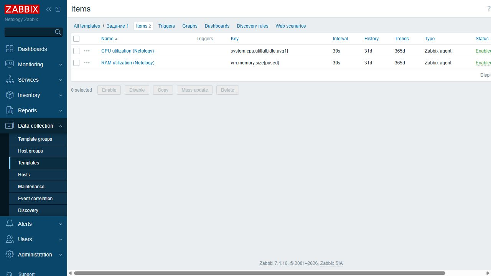
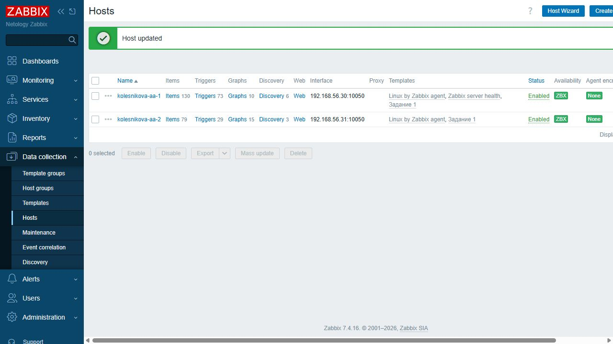
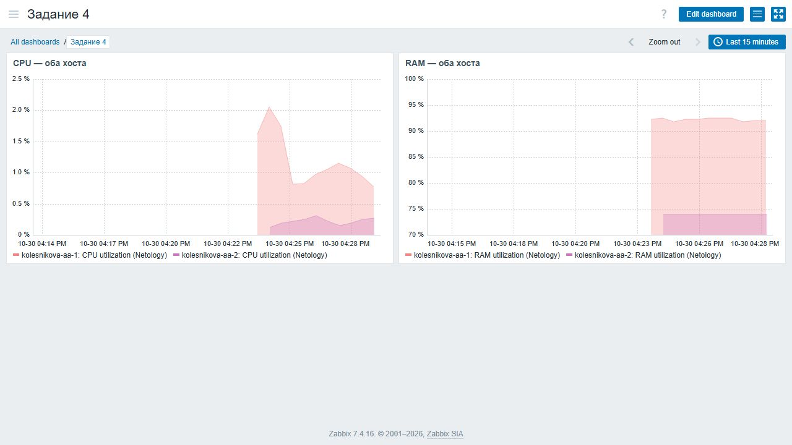

# Домашнее задание к занятию «Система мониторинга Zabbix. Часть 2» — Колесникова Анастасия

[Условие домашнего задания](https://github.com/netology-code/smon-homeworks/blob/main/hw-03.md)

## Задание 1. Собственный шаблон CPU и RAM

В веб-интерфейсе **Data collection → Templates** создан шаблон с отображаемым именем **«Задание 1»** и техническим именем `netology-cpu-ram`. Шаблон размещён в группе `Templates/Operating systems`.

В шаблоне созданы два элемента данных типа **Zabbix agent**. Оба имеют тип информации **Numeric (float)**, единицы измерения `%` и интервал опроса `30s`.

| Элемент данных | Ключ | Обработка значения |
| --- | --- | --- |
| `CPU utilization (Netology)` | `system.cpu.util[all,idle,avg1]` | JavaScript: `return 100 - Number(value);` |
| `RAM utilization (Netology)` | `vm.memory.size[pused]` | Полученный процент использования памяти сохраняется без преобразования |

Ключ CPU возвращает процент простоя всех процессоров за последнюю минуту. Вычитание этого значения из 100 даёт процент загрузки CPU. Оба элемента включены.

## Задания 2–3. Два хоста и привязка шаблонов

В Zabbix настроены два хоста:

| Хост | IP-адрес интерфейса Zabbix Agent | Порт |
| --- | --- | --- |
| `kolesnikova-aa-1` | `192.168.56.30` | `10050` |
| `kolesnikova-aa-2` | `192.168.56.31` | `10050` |

Агенты работают на двух отдельных ВМ Debian 12; на первой ВМ также установлен Zabbix Server. В конфигурации обоих агентов в параметре `Server` разрешён адрес `192.168.56.30`. Имена `Hostname` совпадают с именами хостов в Zabbix.

К каждому хосту привязаны:

- стандартный шаблон `Linux by Zabbix agent`;
- собственный шаблон **«Задание 1»**.

На серверном хосте также сохранён стандартный шаблон `Zabbix server health`, присутствовавший при установке сервера.

На скриншоте видны имена обоих хостов, привязанные шаблоны и зелёные индикаторы доступности `ZBX`.

Поступление значений собственных элементов данных проверено. Эти значения используются на дашборде задания 4.

## Задание 4. Собственный дашборд

В разделе **Dashboards** создан и сохранён дашборд **«Задание 4»** с двумя виджетами типа **Graph**:

- **«CPU — оба хоста»**: загрузка CPU первого и второго хостов по элементу `CPU utilization (Netology)`;
- **«RAM — оба хоста»**: использование RAM первого и второго хостов по элементу `RAM utilization (Netology)`.

На каждом графике отображаются два ряда данных — по одному для каждого хоста. Для просмотра выбран интервал последних 15 минут. На скриншоте видны фактические поступившие значения, шкалы в процентах, название дашборда и подписи обоих хостов.

## Дополнительные задания 5–9*

Не выполнялись. Выполнены все четыре обязательных задания.
